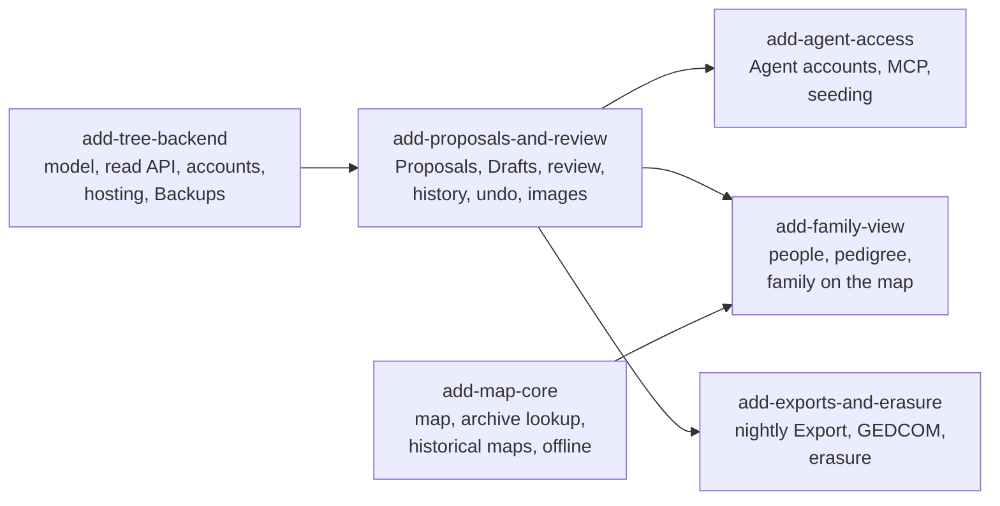

# Rodokmen

A private, shared family tree for one extended family, shown on a map of the Czech lands in the 19th century and earlier. Relatives and AI agents contribute through reviewed Proposals; the map, archive lookup and historical maps work for anyone.

This repo is public and holds code and public reference data only. Family data never goes here.

## Where things are

- [`GLOSSARY.md`](GLOSSARY.md): the words we use, and the ones we avoid.
- [`docs/adr/`](docs/adr/): decisions that are hard to reverse, and why we made them.
- [`docs/architecture/`](docs/architecture/): C4 diagrams generated from one Structurizr model of the spec.
- [`openspec/changes/`](openspec/changes/): what we are building, one OpenSpec change per milestone, each with proposal, specs, design and tasks.
- [`openspec/specs/`](openspec/specs/): how the system behaves once changes are archived (empty until the first one ships).

## Build order

`add-map-core` and `add-tree-backend` can start in parallel. Each change is implemented with `/opsx:apply` and archived with `/opsx:archive` when it ships.
