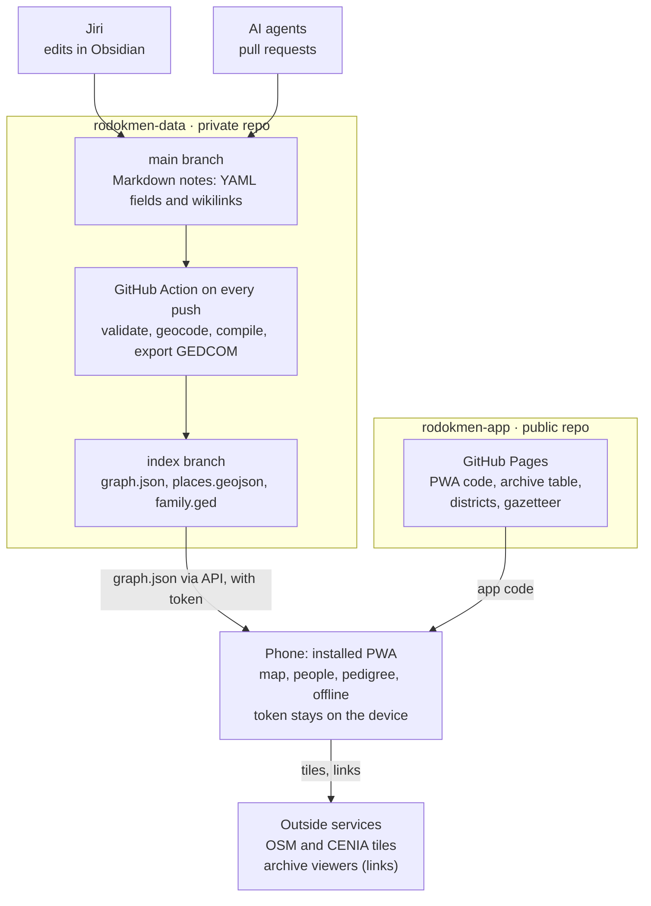
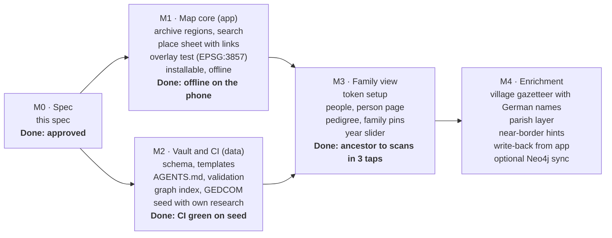

# Rodokmen — Czech genealogy map PWA: spec

Version 0.1 · 2026-10-29 · Jiri

## Summary and goals

Rodokmen is a mobile-first PWA that puts family history on a navigable map of Bohemia, Moravia and Silesia, focused on the 19th century and earlier. The family data lives as Markdown notes in a private Git repo. Jiri edits it in Obsidian, agents add findings as commits, and a GitHub Action compiles it into a graph that the app loads.

Goals:

1. **One tap from village to scans.** For any place, show which archive holds its parish registers (matriky) and open that archive's online viewer. Also list the historical maps that show the place.
2. **Family on the map through time.** Show where each ancestor was born, married, lived (house number, čp.) and died, filtered by year.
3. **Agent-friendly data.** An agent can add a person or a finding, with its source, as one reviewable commit that passes validation.
4. **Works offline.** Usable in an archive reading room or a village without signal, after one online visit.
5. **No lock-in.** The vault is plain Markdown, and every build also exports GEDCOM.

Users: Jiri (primary, phone and desktop), AI agents (writers through Git), and possibly family members later (read-only).

Acceptance criteria for v1:

- From a village on the map, the matching archive's register viewer opens in at most 2 taps.
- An agent adds a person plus source in one commit, and CI stays green.
- The app installs from Android Chrome and reopens offline with the last-loaded data.

## Scope

v1 is the map, the vault and a read-only family view. Editing in the app and a graph database come later.

| Area | v1 | Later |
| --- | --- | --- |
| Map | Archive regions, place search, place sheet with register and map links, historical overlays (if the WMS check in M1 passes) | Parish layer, German place names, near-border hints |
| Family | People list, person page, pedigree, family pins, year slider | Descendant charts, life-path animation |
| Data | Vault schema, templates, AGENTS.md, CI validation, graph index, GEDCOM export | Neo4j sync, MCP server for agents |
| Editing | Obsidian and agents through Git; the app links to each note | Write-back from the app through the GitHub API |
| Coverage | Archive lookup and historical layers for the Czech lands | Places outside the Czech lands get pins but no archive lookup (the schema already allows them) |

Non-goals:

- Mirroring or scraping archive scans. The app links to the archives' own viewers and respects their terms.
- A public family-tree website. Family data stays private.
- Transcription or OCR of register pages, and DNA matching.

## Architecture

Two GitHub repos and one build step: notes go in the private repo, the Action compiles them, and the phone loads the public app plus the private graph.



Jiri and agents write to `main`, and the Action turns every push into the `index` branch. The phone gets the app from GitHub Pages and the graph from the private repo with its own token. In v1 nothing flows back from the app.

## Vault (rodokmen-data)

The vault is an Obsidian-compatible folder of Markdown notes, one note per thing, with typed YAML frontmatter and `[[wikilinks]]` between notes. Frontmatter holds the facts the app needs. The note body holds research notes, transcriptions and doubts.

```
rodokmen-data/
  AGENTS.md          rules for agents (CLAUDE.md just points here)
  README.md
  people/            one note per person        jan-novak-1801.md
  houses/            one note per house         dolni-lhota-cp-12.md
  places/            one note per settlement    dolni-lhota.md
  parishes/          one note per parish        farnost-horni-lhota.md
  registers/         one note per register book soa-zamrsk-123-4567.md
  sources/           one note per record found  n-horni-lhota-1801-p14.md
  log/               research log, one per session  2026-10-29-novak-line.md
  templates/         Obsidian templates, one per type
  schema/            JSON Schema per type (used by CI)
  scripts/           validate.mjs, build-index.mjs
  .github/workflows/ build-index.yml
```

Examples in this spec use invented people and places.

### Note types

| Type | Folder | File name (= id) | Key fields |
| --- | --- | --- | --- |
| person | people/ | `given-surname-birthyear`, `-x` if the year is unknown, `-2` on a clash | name, sex, birth, baptism, death, burial, father, mother, marriages, residences, occupation, living, confidence |
| house | houses/ | `place-cp-number` (current or best-known number) | place, numbers over time, lat/lon (optional) |
| place | places/ | ASCII slug of the Czech name | name, names (de, la), kind, lat, lon, district, parishes over time, estate (panství), archive override |
| parish | parishes/ | `farnost-<seat>`, `evang-<seat>`, `zid-<seat>` | name, seat, denomination, from/to, diocese |
| register | registers/ | `<archive>-<fond or signature>` | archive, signature, parish, kind (N births, O marriages, Z deaths, I index), years, places covered, url |
| source | sources/ | `<kind>-<parish>-<year>-p<page>` | register, page or frame, url, date of the entry, transcription, accessed |

House numbers were introduced in 1770–71 and villages were often renumbered later, so a house note lists each number with its period. Villages also moved between parishes, so a place note lists parishes with periods.

### Person note

```yaml
---
type: person
name:
  given: Jan
  surname: Novák
  birth_surname:            # women: maiden name
  variants: [Nowak, Johann Nowak, Joannes Nowak]
sex: M
birth:    { date: 1801-03-14, place: "[[dolni-lhota]]", house: "[[dolni-lhota-cp-12]]", source: "[[n-horni-lhota-1801-p14]]" }
baptism:  { date: 1801-03-15, place: "[[farnost-horni-lhota]]", source: "[[n-horni-lhota-1801-p14]]" }
death:    { date: 1863~, place: "[[dolni-lhota]]" }
father: "[[josef-novak-1770]]"
mother: "[[anna-dvorakova-1775]]"
marriages:
  - spouse: "[[marie-kralova-1805]]"
    date: 1826-11-20
    place: "[[farnost-horni-lhota]]"
    source: "[[o-horni-lhota-1826-p3]]"
residences:
  - { house: "[[dolni-lhota-cp-12]]", from: 1801, to: 1863, role: owner }
occupation: [sedlák]
living: false
confidence: confirmed       # confirmed | probable | hypothesis
tags: [line/novak]
---
Research notes, transcription in the original language, open questions.
```

### Conventions

- **Links point at ids only.** A link is `[[file-name]]` without folder or extension. Ids never change once created; a rename keeps the old id in `aliases`.
- **One fact, one place.** Children, siblings and backlinks are derived by the build, never stored. The one exception: a marriage is written on both spouses so Obsidian backlinks work, and CI checks that both sides agree.
- **Dates use an EDTF subset** (ISO 8601-2): `1801-03-14`, `1801-03`, `1801`, `1801~` (about), `1801?` (uncertain), `1801/1803` (between), `../1805` (before), `1790/..` (after). The GEDCOM export maps these to ABT, BEF, AFT and BET.
- **Names** use modern Czech spelling in `given` and `surname`. Every spelling actually found (Latin, German, Czech) goes in `variants`.
- **Coordinates** are WGS84 decimal degrees with 5 decimals. Leave them empty if unknown; the build geocodes them and reports the guess for confirmation.
- **Confidence** is per person. A fact without a `source` is allowed only when the person is `hypothesis` or the note body says where the fact came from (for example family memory).
- **Living** defaults to true for anyone born within the last 100 years with no recorded death. Living people never leave the private repo (see Privacy).

## Agent conventions (AGENTS.md)

Agents work through Git like a careful research assistant: they search before they create, cite every fact, and send their work as a pull request that Jiri merges. AGENTS.md states these rules, and CI enforces the ones a machine can check.

1. **Read first.** Read AGENTS.md, the schema of the type you are writing, and the latest file in `log/`.
2. **Search before creating.** Before adding a person, search `people/` by surname and every variant, a birth year within ±5 years, and the place. A likely match gets extended, not duplicated.
3. **Cite or mark.** Every new fact links a `source` note. That note holds the register, the page or frame, the URL of the scan and a transcription in the original language. Without a source, set `confidence: hypothesis` and say why in the body.
4. **Never invent.** No guessed dates, places or parents. Write unknowns as empty fields or as an open question in the body.
5. **Log negative results.** Each session adds a `log/` note listing what was searched (register, years, pages) and what was not found. A search that found nothing still matters.
6. **One finding per commit, all of it on a branch.** Commit messages look like `add: Jan Novák (1801) from N Horní Lhota 1784–1820 p.14`. Agents push to `agent/<topic>` and open a PR; only Jiri commits to `main`.
7. **Validate before pushing.** Run `npm run validate`. The PR check runs it too and posts the report as a comment.
8. **No scans in Git.** Link to the archive viewer. Optional crops go in `attachments/`, at most 1 MB each.
9. **Don't touch generated files.** The `index` branch and anything under `schema/` change only through their own process.

What CI checks (errors fail the PR, warnings are reported):

| Check | Level |
| --- | --- |
| Frontmatter matches the JSON Schema of its type | error |
| Every `[[link]]` resolves to an existing id | error |
| Duplicate ids, or an id that differs from its file name | error |
| Date syntax is valid EDTF subset | error |
| Marriage recorded on one spouse only, or the two sides disagree | warning |
| Parent born less than 13 or more than 60 years before the child (mother: more than 50) | warning |
| Event after the person's death, or before their birth | warning |
| Possible duplicate person: same normalized name and birth year within 2 years | warning |
| Place without coordinates (geocoded guess listed) | warning |

Later, an MCP server can wrap the same operations (find person, add source, add person) for agents that cannot use Git directly. The Markdown stays the source of truth either way.

## Build pipeline

Every push to `main` in rodokmen-data runs one GitHub Action that validates the vault and publishes a compiled index to an orphan `index` branch in the same private repo. Pull requests run steps 1–2 only and comment the report.

1. **Parse.** Read every note and split the frontmatter from the body. Node 22 with the `yaml` package; JSON Schema checks with `ajv`.
2. **Validate.** Run the checks in the table above and write `report.md` (errors, warnings, counts per type).
3. **Geocode.** For places without coordinates, look up the app's gazetteer by name and district first. Then try Nominatim restricted to `countrycodes=cz`, at most 1 request per second. Guesses are cached in `geocache.json` on the `index` branch and listed in the report. They are never written back into notes.
4. **Compile.** Write `graph.json` (below), `places.geojson` (every place with its events), `search.json` (normalized names and variants) and `family.ged` (GEDCOM 5.5.1, the version most programs import).
5. **Publish.** Force-push the outputs as a single commit to `index`. The app reads only this branch, so `main` stays plain notes.

```json
{
  "version": 1,
  "generated": "2026-10-29T08:00:00Z",
  "commit": "<sha of main>",
  "people":   [{ "id": "jan-novak-1801", "name": "Jan Novák", "sex": "M",
                 "birth": { "date": "1801-03-14", "year": 1801, "place": "dolni-lhota", "house": "dolni-lhota-cp-12", "source": "n-horni-lhota-1801-p14" },
                 "death": { "date": "1863~", "year": 1863, "place": "dolni-lhota" },
                 "father": "josef-novak-1770", "mother": "anna-dvorakova-1775",
                 "living": false, "confidence": "confirmed", "path": "people/jan-novak-1801.md" }],
  "places":   [{ "id": "dolni-lhota", "name": "Dolní Lhota", "names": { "de": "Unter Lhota" }, "lat": null, "lon": null,
                 "geocoded": true, "district": "…", "archive": "soa-zamrsk", "parishes": [{ "id": "farnost-horni-lhota", "from": 1784 }] }],
  "houses":    [], "parishes": [], "registers": [], "sources": [],
  "events":   [{ "person": "jan-novak-1801", "kind": "birth", "year": 1801, "place": "dolni-lhota" }],
  "edges":    [{ "from": "jan-novak-1801", "to": "josef-novak-1770", "type": "father" }]
}
```

The `events` and `edges` arrays are derived, so the app needs no graph logic of its own beyond walking them. The same `edges` list is what a later Neo4j sync would load.

## PWA (rodokmen-app)

The app is a full-screen map with four tabs at the bottom: Map, People, Sources and Settings. It is static HTML, CSS and ES modules with Leaflet 1.9 vendored, no framework and no build step, so agents can edit it as easily as the vault. The UI ships in Czech and English and follows the browser language.

### Map

- Base layer: OpenStreetMap tiles. Overlays: 2nd military survey (1836–1852) and 3rd military survey special maps, each with an opacity slider. Also archive regions (districts tinted by archive) and family pins.
- Search across the gazetteer, vault places and people. Search ignores diacritics, so `zdar` finds `Žďár`. German names also match once the gazetteer has them.
- Year slider from 1600 to 1950 with a range handle. Pins show only events inside the range. A play button steps through decades.
- Without network, the vector layers (districts, borders, pins) still draw; tiles show what was cached.

### Place sheet (tap a place)

- Name, German name, district, today's municipality, and the land (Bohemia, Moravia or Silesia) when known.
- **Registers:** the archive that holds them, with an "Open scans" button to its viewer (village search where the portal supports it, as MZA does). Register books from the vault for this place are listed with their years and direct links.
- A hint when the place is within 5 km of a border between two archives: "the parish seat may be across the line, also check &lt;archive&gt;".
- Parishes over time and the estate (panství), from the vault.
- Family here: births, marriages, deaths and residences, grouped by person, with years.
- Historical maps: ČÚZK Archiv (imperial imprints of the stable cadastre), OldMapsOnline place page, Arcanum Maps.

### People

- List with diacritic-free search over names and variants, filters by line tag and by confidence.
- Person page: vitals with tappable places, parents, spouses, children, a timeline, and sources with links to the scans. Each page has two links: "Edit on GitHub" and "Open in Obsidian" (an `obsidian://open` link).
- Pedigree: ancestors up to 6 generations; tap a box to centre on that person. Descendants as an indented list.
- "Show on map" draws the person's life path (birth, residences, death) with years.

### Sources

A built-in guide to what exists for each era, linked to the archive portals:

| Era | Main sources |
| --- | --- |
| Before 1650 | Urbáře and land books (gruntovní knihy) of estates; the oldest parish registers |
| 1650–1784 | Soupis poddaných podle víry (1651), Berní rula (1654), Catholic parish registers, Tereziánský katastr, first house numbering (1770–71) |
| 1784–1850 | Pre-printed register columns from 1784, Josefský katastr, stable cadastre (1824–1843) with its indication sketches, Sommer's topography of Bohemia and Wolny's of Moravia |
| 1850–1900 | Censuses (1857, 1869, 1880, 1890, 1900), 3rd military survey, Jewish registers at the National Archives |

### Settings

- Data source: GitHub (owner, repo, branch, token), a local `graph.json` file, or the built-in demo with invented people.
- Language, storage used, "Check map layers" (loads one tile from each overlay and reports which work), and "Forget this device".

## Reference data (public, in rodokmen-app)

The archive for a place is looked up from its district (okres). The archives' regions follow the regions of 1960–2000, and parishes are filed under the archive of their seat. Archive names and portal URLs live in one file, `data/archives.json`, which a weekly CI job checks for broken links.

### Archives holding parish registers

| Archive | Districts | Online registers |
| --- | --- | --- |
| SOA Praha | Benešov, Beroun, Kladno, Kolín, Kutná Hora, Mělník, Mladá Boleslav, Nymburk, Praha-východ, Praha-západ, Příbram, Rakovník | [eBadatelna](https://ebadatelna.soapraha.cz/) |
| Archiv hl. m. Prahy | Praha (city) | [Praga Publica](https://katalog.ahmp.cz/pragapublica/) |
| SOA Třeboň | České Budějovice, Český Krumlov, Jindřichův Hradec, Pelhřimov, Písek, Prachatice, Strakonice, Tábor | [Digitální archiv](https://digi.ceskearchivy.cz/) |
| SOA Plzeň | Domažlice, Cheb, Karlovy Vary, Klatovy, Plzeň-jih, Plzeň-město, Plzeň-sever, Rokycany, Sokolov, Tachov | [Porta fontium](https://www.portafontium.eu/) |
| SOA Litoměřice | Česká Lípa, Děčín, Chomutov, Jablonec nad Nisou, Liberec, Litoměřice, Louny, Most, Teplice, Ústí nad Labem | [Vademecum](https://vademecum.soalitomerice.cz/vademecum/) |
| SOA Zámrsk | Havlíčkův Brod, Hradec Králové, Chrudim, Jičín, Náchod, Pardubice, Rychnov nad Kněžnou, Semily, Svitavy, Trutnov, Ústí nad Orlicí | [ARON](https://aron.vychodoceskearchivy.cz/) |
| MZA Brno | Blansko, Brno-město, Brno-venkov, Břeclav, Hodonín, Jihlava, Kroměříž, Prostějov, Třebíč, Uherské Hradiště, Vyškov, Zlín, Znojmo, Žďár nad Sázavou | [Acta Publica](https://www.mza.cz/actapublica/) |
| Zemský archiv Opava | Bruntál, Frýdek-Místek, Jeseník, Karviná, Nový Jičín, Olomouc, Opava, Ostrava-město, Přerov, Šumperk, Vsetín | [Digitální archiv](https://digi.archives.cz/da/) |
| Národní archiv | Jewish registers for all of the Czech lands | [Vademecum NA](https://vademecum.nacr.cz/vademecum/) |

Military registers sit in the Military Central Archive (VÚA). The app mentions them in the Sources guide but does not map them.

### Map layers and map links

| Layer | Period | How the app uses it |
| --- | --- | --- |
| 2nd military survey, CENIA [WMS](https://geoportal.gov.cz/ArcGIS/services/CENIA/cenia_rt_II_vojenske_mapovani/MapServer/WMSServer) | 1836–1852 | Overlay, if it serves Web Mercator (EPSG:3857). The metadata lists only S-JTSK (EPSG:5514), so M1 tests this first |
| 3rd military survey special maps 1:75 000, CENIA [WMS](https://geoportal.gov.cz/ArcGIS/services/CENIA/cenia_rt_III_vojenske_mapovani/MapServer/WMSServer) | 1870s–1880s | Overlay, same test |
| Imperial imprints of the stable cadastre, ČÚZK [Archiv](https://ags.cuzk.cz/archiv/) | 1824–1843, 1:2 880 | Link out; no open tile service found |
| Arcanum Maps (mapire) | 1st–3rd surveys | Link out only; its tile terms are not checked |
| OldMapsOnline | various | Link out to the place page by name |

If neither CENIA layer serves EPSG:3857, there are two fallbacks. One is the CENIA WMTS in S-JTSK through Proj4Leaflet, which needs a separate map projection for that view. The other is to drop the overlays and keep the link-outs.

### Gazetteer and boundaries

- **Districts:** 77 district polygons from [siwekm/czech-geojson](https://github.com/siwekm/czech-geojson) (derived from RÚIAN). The file carries no names, so the build names each polygon by the municipalities that fall inside it. It then simplifies the polygons to about 300 KB.
- **Municipalities (v1):** 6,258 municipalities with district and coordinates from [33bcdd/souradnice-mest](https://github.com/33bcdd/souradnice-mest).
- **Villages (v1.1):** many ancestral villages are only parts of a municipality, not municipalities of their own. A monthly workflow pulls every `place=city|town|village|hamlet` in Czechia from OpenStreetMap (Overpass) with `name:de`, and commits `data/places.json` (ODbL, credited in the app).

## Privacy and security

No family data ever reaches the public repo or the public site. The app is a public shell; the data arrives only on devices that hold a token.

- **Split.** rodokmen-app (public, GitHub Pages) holds code, public reference data and an invented demo dataset. rodokmen-data (private) holds the notes and the `index` branch. A CI check in rodokmen-app fails if the repo gains a `people/` folder or any `graph.json` other than the demo.
- **Token.** The app reads `graph.json` through the GitHub REST contents API with a fine-grained personal access token. The token is scoped to rodokmen-data only, with Contents read-only permission and an expiry of at most one year. It is stored in IndexedDB on the device and sent only to `api.github.com`.
- **On the device.** The last graph is cached in IndexedDB for offline use. "Forget this device" deletes the token, the graph and the cached tiles.
- **Living people.** Notes with `living: true` stay in the vault and in the private index. They are left out of `family.ged` and any future export unless the export is run with an explicit flag.
- **Third parties.** Tile servers see which map areas are viewed. Nominatim sees place names only during CI geocoding, never from the app. The app has no analytics and no cookies.
- **URLs.** Views use hash routes with ids only (`#person/jan-novak-1801`). A link opened without a token shows nothing personal.

## Offline and PWA details

After one online visit, the app, its reference data and the last family graph work without network; map tiles work only where they were already viewed.

| Asset | Strategy | Budget |
| --- | --- | --- |
| App shell (HTML, CSS, JS, Leaflet, icons) | Precached by the service worker, versioned per release | ~300 KB |
| Reference data (archives, districts, municipalities) | Precached; villages file cached on first use | ~1.5 MB, villages ~3 MB |
| Family graph | Fetched with the token, kept in IndexedDB; refreshed on open when online | grows with the vault |
| Map tiles (OSM, CENIA) | Runtime cache of viewed tiles only, least-recently-used eviction | 2,000 tiles |

- No bulk tile download. The OpenStreetMap tile policy forbids prefetching, and the CENIA terms for bulk use are unknown.
- Manifest: name Rodokmen, `display: standalone`, `start_url` and `scope` set to `/rodokmen-app/`, icons 192 and 512 px plus a maskable 512 px icon.
- Updates: a new service worker waits, and the app shows "New version, reload". Nothing reloads by itself while a person is reading.
- Hosting: GitHub Pages, deployed by a workflow on every push to `main`. A custom domain can be added later.
- Tests: Playwright smoke tests in CI with headless Chromium cover load, search, the place sheet, the demo dataset, and an offline reload.

## Milestones

M1 (app) and M2 (vault) can run at the same time; M3 joins them, and M4 is optional polish.



The overlay test in M1 decides early whether the historical layers are embedded or only linked. M2 seeds the vault with the research already done, so M3 is tested on real data.

## Open questions

- [ ] Do the CENIA WMS layers answer EPSG:3857 requests? If not, use S-JTSK via Proj4Leaflet, or link out only. Test in M1.
- [ ] Semily district: registers listed under Zámrsk, while its district archive belongs to SOA Litoměřice. Confirm, and check Brno city parishes (MZA or the Brno city archive).
- [ ] Litoměřice and Opava are moving to a new Digitální badatelna portal. Switch the URLs in `archives.json` when it leaves trial.
- [ ] GEDCOM 5.5.1 or 7.0? Depends on which program the export is opened in.
- [ ] Should family members get read access? Each would need a GitHub account and a token, or a separate read-only export.
- [ ] Write-back in v2: direct commits to `main`, or PRs like agents?
- [ ] Lines outside the Czech lands: same vault, or a separate one?
- [ ] Obsidian on the phone: sync the vault with the Obsidian Git plugin, or read it in the app only?

## Sources

- [Regional archives and their districts](https://myczechroots.com/archives/regional-archives), My Czech Roots
- [Internet sources of Czech church record images](https://www.wwjohnston.net/famhist/czech-research.htm) (Havlíčkův Brod in Zámrsk, Pelhřimov in Třeboň)
- [CENIA metadata: 2nd military survey view service](https://micka.cenia.cz/en/record/full/4e678953-ba1c-49a2-a61e-3b96c0a80137) (WMS and WMTS URLs, S-JTSK)
- [ÚAZK news](https://cuzk.gov.cz/Urady/Zememericky-urad/Dalsi-informace/UAZK/Aktuality-a-sdeleni-Ustredniho-archivu-zememerictv.aspx) (Archiv app, imperial imprints, Digitální badatelna)
- [siwekm/czech-geojson](https://github.com/siwekm/czech-geojson) and [33bcdd/souradnice-mest](https://github.com/33bcdd/souradnice-mest) (downloaded and inspected)
- [SOA Praha eBadatelna](https://ebadatelna.soapraha.cz/) (register holding periods: births after 100 years, marriages and deaths after 75)
