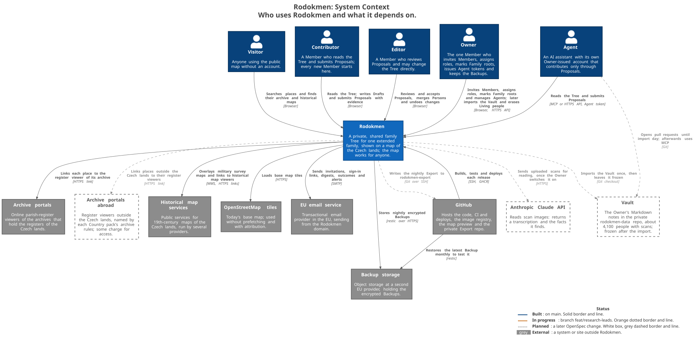
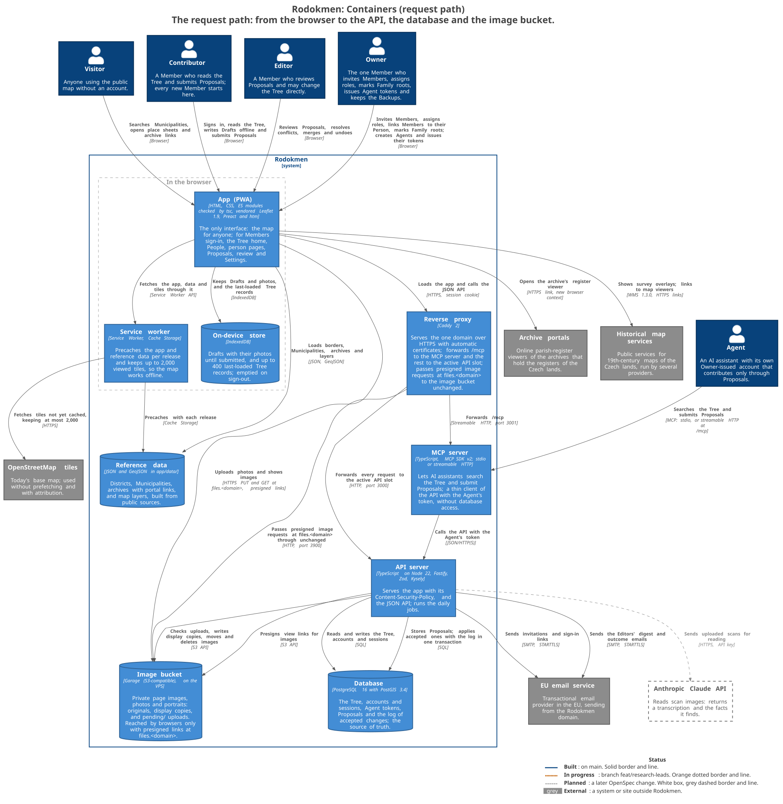
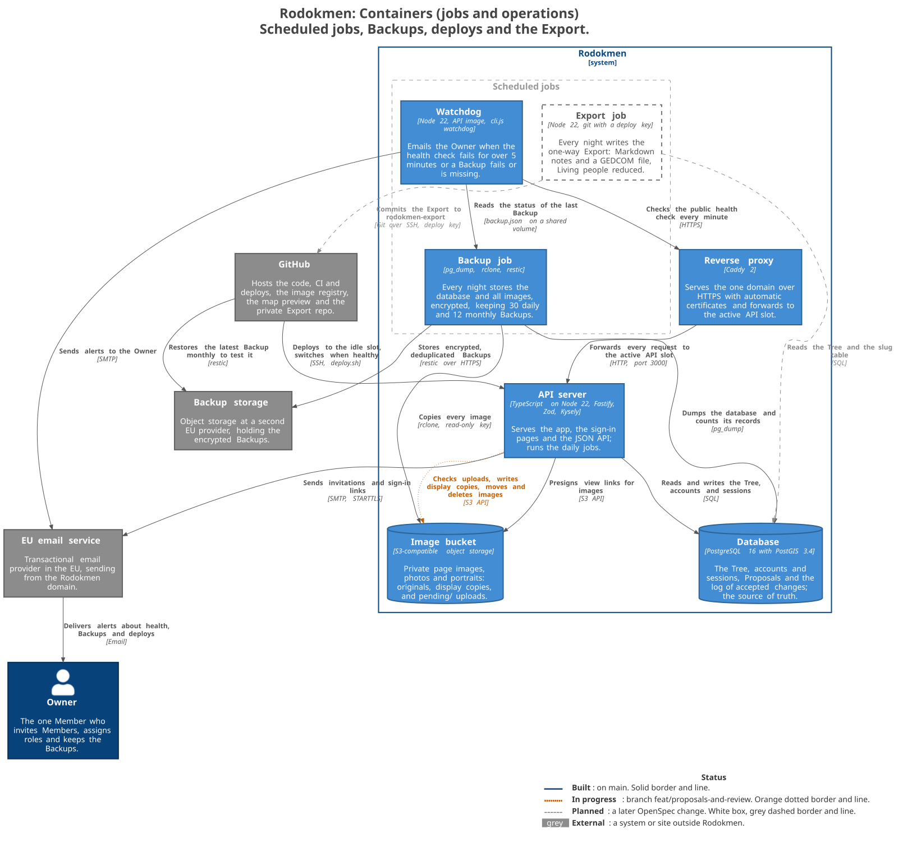
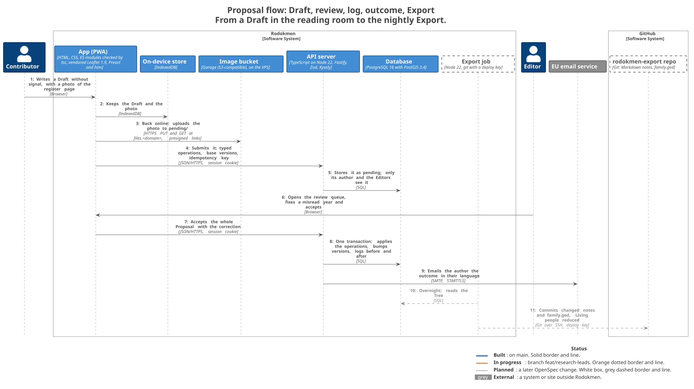
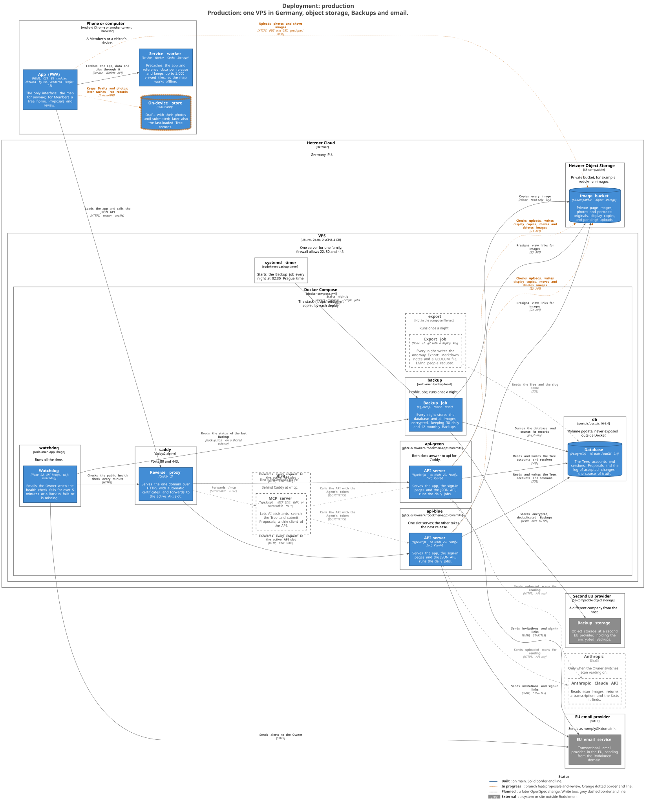
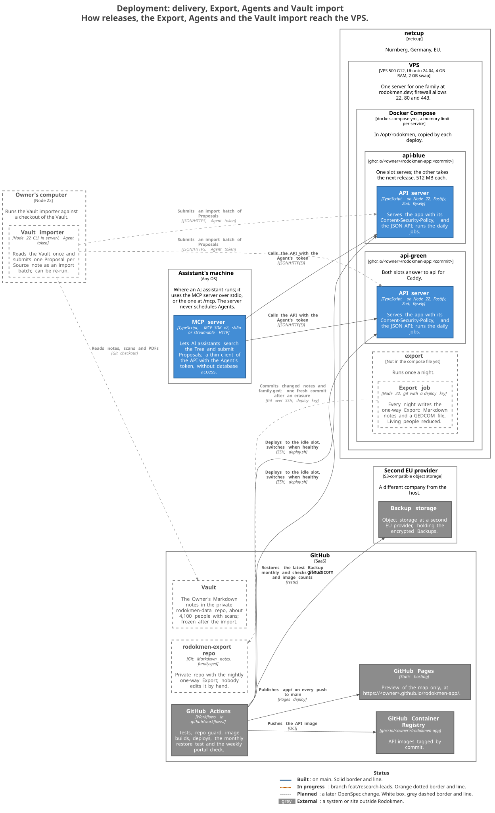

# Architecture (C4)

[`workspace.dsl`](workspace.dsl) is a Structurizr model of Rodokmen and the single source of every diagram here. It is derived from the OpenSpec changes in [`openspec/changes/`](../../openspec/changes/): each capability (spec folder) becomes a container or component, and its requirements become the relationships. It also draws on the ADRs in [`docs/adr/`](../adr/), [`deploy/`](../../deploy/) and the code. Every element and relationship has a status tag: **Built** (on main), **In progress** (branch `feat/research-leads`, `add-research-leads`) or **Planned** (a later change: `add-vault-import` beyond the Family roots and the relation to the family, `add-scan-reading`, `add-exports-and-erasure` and `add-country-packs`). Each also carries properties: `openspec` (change / capability), `adr`, and `code` where the code exists. The words follow [`GLOSSARY.md`](../../GLOSSARY.md).

In the SVGs, Built elements have solid borders, In progress elements orange dotted ones, and Planned elements are white boxes with grey dashed borders; lines follow the same scheme. Every SVG has the legend. Mermaid copies of all views are in [`generated/mermaid.md`](generated/mermaid.md); Mermaid shows status by colour only.

## Views

|                                                 |                                               |
| ----------------------------------------------- | --------------------------------------------- |
|         |           |
|  |        |
|             |  |

All views are in [`generated/svg/`](generated/svg/):

1. `01-system-context`: people and external systems
2. `02-containers`: the request path
3. `03-containers-operations`: jobs, Backups, deploys and the Export
4. `04-app-map`: the public map
5. `05-archive-portals` and `06-historical-map-services`: what the place sheet links to
6. `07-app-proposals` and `08-app-family`: app components (Proposals and review; sign-in, the Tree home, the family screens and Settings)
7. `09-api-core`, `10-api-write-path`, `11-api-agents-import`, `12-api-research` and `13-api-exports-erasure`: API server components, one view per group of changes
8. `14-proposal-flow`: dynamic view, from a Draft to the nightly Export
9. `15-deployment` and `16-deployment-delivery`: production

## Regenerating

```sh
docs/architecture/generate.sh                   # validate, export Mermaid and C4-PlantUML, render SVG
PNG_DIR=/tmp/c4-png docs/architecture/generate.sh   # also PNGs, outside the repo (the repo guard refuses raster images)
```

The script needs only Docker. It runs the pinned images `structurizr/structurizr:2026.10.26` and `plantuml/plantuml:1.2026.9`. Don't use `structurizr/cli`: its last image only prints a deprecation notice, exits 0, and validates nothing. [`legend.puml`](legend.puml) replaces C4-PlantUML's legend in every diagram. Commit `generated/` together with the model: the `architecture` workflow fails when they differ.
