# Rodokmen C4 diagrams (Mermaid)

Generated by `docs/architecture/generate.sh` from `docs/architecture/workspace.dsl`; do not edit.
Mermaid shows status by colour only: blue borders are Built, orange In progress, white boxes
with grey text Planned. The SVGs in [svg/](svg/) also show dashed and dotted borders and a legend.

## 01-system-context

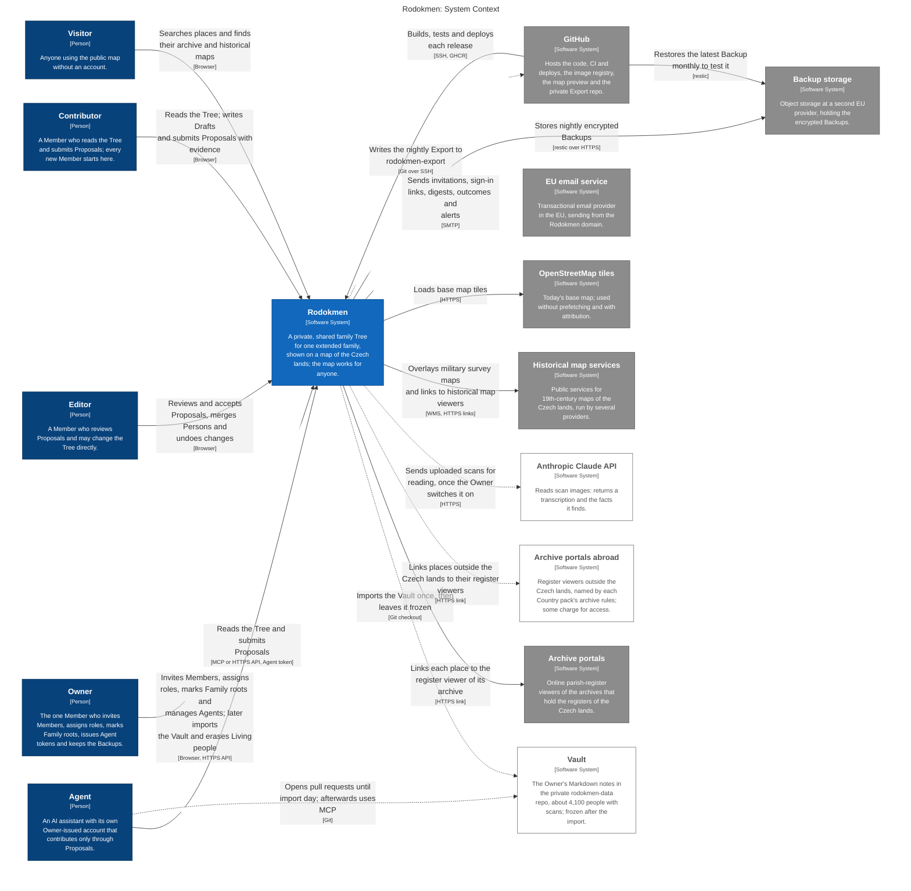

## 02-containers

```mermaid
graph TB
  linkStyle default fill:#ffffff

  subgraph diagram ["Rodokmen: Containers (request path)"]
    style diagram fill:#ffffff,stroke:#ffffff

    1["<div style='font-weight: bold'>Visitor</div><div style='font-size: 70%; margin-top: 0px'>[Person]</div><div style='font-size: 80%; margin-top:10px'>Anyone using the public map<br />without an account.</div>"]
    style 1 fill:#08427b,stroke:#052e56,color:#ffffff
    2["<div style='font-weight: bold'>Contributor</div><div style='font-size: 70%; margin-top: 0px'>[Person]</div><div style='font-size: 80%; margin-top:10px'>A Member who reads the Tree<br />and submits Proposals; every<br />new Member starts here.</div>"]
    style 2 fill:#08427b,stroke:#052e56,color:#ffffff
    3["<div style='font-weight: bold'>Editor</div><div style='font-size: 70%; margin-top: 0px'>[Person]</div><div style='font-size: 80%; margin-top:10px'>A Member who reviews<br />Proposals and may change the<br />Tree directly.</div>"]
    style 3 fill:#08427b,stroke:#052e56,color:#ffffff
    4["<div style='font-weight: bold'>Owner</div><div style='font-size: 70%; margin-top: 0px'>[Person]</div><div style='font-size: 80%; margin-top:10px'>The one Member who invites<br />Members, assigns roles, marks<br />Family roots, issues Agent<br />tokens and keeps the Backups.</div>"]
    style 4 fill:#08427b,stroke:#052e56,color:#ffffff
    5["<div style='font-weight: bold'>Agent</div><div style='font-size: 70%; margin-top: 0px'>[Person]</div><div style='font-size: 80%; margin-top:10px'>An AI assistant with its own<br />Owner-issued account that<br />contributes only through<br />Proposals.</div>"]
    style 5 fill:#08427b,stroke:#052e56,color:#ffffff
    52["<div style='font-weight: bold'>Archive portals</div><div style='font-size: 70%; margin-top: 0px'>[Software System]</div><div style='font-size: 80%; margin-top:10px'>Online parish-register<br />viewers of the archives that<br />hold the registers of the<br />Czech lands.</div>"]
    style 52 fill:#8c8c8c,stroke:#616161,color:#ffffff
    63["<div style='font-weight: bold'>Historical map services</div><div style='font-size: 70%; margin-top: 0px'>[Software System]</div><div style='font-size: 80%; margin-top:10px'>Public services for<br />19th-century maps of the<br />Czech lands, run by several<br />providers.</div>"]
    style 63 fill:#8c8c8c,stroke:#616161,color:#ffffff
    69["<div style='font-weight: bold'>OpenStreetMap tiles</div><div style='font-size: 70%; margin-top: 0px'>[Software System]</div><div style='font-size: 80%; margin-top:10px'>Today's base map; used<br />without prefetching and with<br />attribution.</div>"]
    style 69 fill:#8c8c8c,stroke:#616161,color:#ffffff
    70["<div style='font-weight: bold'>EU email service</div><div style='font-size: 70%; margin-top: 0px'>[Software System]</div><div style='font-size: 80%; margin-top:10px'>Transactional email provider<br />in the EU, sending from the<br />Rodokmen domain.</div>"]
    style 70 fill:#8c8c8c,stroke:#616161,color:#ffffff
    72["<div style='font-weight: bold'>Anthropic Claude API</div><div style='font-size: 70%; margin-top: 0px'>[Software System]</div><div style='font-size: 80%; margin-top:10px'>Reads scan images: returns a<br />transcription and the facts<br />it finds.</div>"]
    style 72 fill:#ffffff,stroke:#777777,color:#555555

    subgraph 6 ["Rodokmen"]
      style 6 fill:#ffffff,stroke:#0b4884,color:#0b4884

      subgraph group1 ["In the browser"]
        style group1 fill:#ffffff,stroke:#555555,color:#555555,stroke-dasharray:5

        23["<div style='font-weight: bold'>Service worker</div><div style='font-size: 70%; margin-top: 0px'>[Container: Service Worker, Cache Storage]</div><div style='font-size: 80%; margin-top:10px'>Precaches the app and<br />reference data per release<br />and keeps up to 2,000 viewed<br />tiles, so the map works<br />offline.</div>"]
        style 23 fill:#438dd5,stroke:#2e6295,color:#ffffff
        24[("<div style='font-weight: bold'>On-device store</div><div style='font-size: 70%; margin-top: 0px'>[Container: IndexedDB]</div><div style='font-size: 80%; margin-top:10px'>Drafts with their photos<br />until submitted, and up to<br />400 last-loaded Tree records;<br />emptied on sign-out.</div>")]
        style 24 fill:#438dd5,stroke:#2e6295,color:#ffffff
        7["<div style='font-weight: bold'>App (PWA)</div><div style='font-size: 70%; margin-top: 0px'>[Container: HTML, CSS, ES modules checked by tsc, vendored Leaflet 1.9, Preact and htm]</div><div style='font-size: 80%; margin-top:10px'>The only interface: the map<br />for anyone; for Members<br />sign-in, the Tree home,<br />People, person pages,<br />Proposals, review and<br />Settings.</div>"]
        style 7 fill:#438dd5,stroke:#2e6295,color:#ffffff
      end

      25[("<div style='font-weight: bold'>Reference data</div><div style='font-size: 70%; margin-top: 0px'>[Container: JSON and GeoJSON in app/data/]</div><div style='font-size: 80%; margin-top:10px'>Districts, Municipalities,<br />archives with portal links,<br />and map layers, built from<br />public sources.</div>")]
      style 25 fill:#438dd5,stroke:#2e6295,color:#ffffff
      26["<div style='font-weight: bold'>Reverse proxy</div><div style='font-size: 70%; margin-top: 0px'>[Container: Caddy 2]</div><div style='font-size: 80%; margin-top:10px'>Serves the one domain over<br />HTTPS with automatic<br />certificates; forwards /mcp<br />to the MCP server and the<br />rest to the active API slot;<br />passes presigned image<br />requests at files.<domain> to<br />the image bucket unchanged.</div>"]
      style 26 fill:#438dd5,stroke:#2e6295,color:#ffffff
      27["<div style='font-weight: bold'>API server</div><div style='font-size: 70%; margin-top: 0px'>[Container: TypeScript on Node 22, Fastify, Zod, Kysely]</div><div style='font-size: 80%; margin-top:10px'>Serves the app with its<br />Content-Security-Policy, and<br />the JSON API; runs the daily<br />jobs.</div>"]
      style 27 fill:#438dd5,stroke:#2e6295,color:#ffffff
      45["<div style='font-weight: bold'>MCP server</div><div style='font-size: 70%; margin-top: 0px'>[Container: TypeScript, MCP SDK v2; stdio or streamable HTTP]</div><div style='font-size: 80%; margin-top:10px'>Lets AI assistants search the<br />Tree and submit Proposals; a<br />thin client of the API with<br />the Agent's token, without<br />database access.</div>"]
      style 45 fill:#438dd5,stroke:#2e6295,color:#ffffff
      47[("<div style='font-weight: bold'>Database</div><div style='font-size: 70%; margin-top: 0px'>[Container: PostgreSQL 16 with PostGIS 3.4]</div><div style='font-size: 80%; margin-top:10px'>The Tree, accounts and<br />sessions, Agent tokens,<br />Proposals and the log of<br />accepted changes; the source<br />of truth.</div>")]
      style 47 fill:#438dd5,stroke:#2e6295,color:#ffffff
      48[("<div style='font-weight: bold'>Image bucket</div><div style='font-size: 70%; margin-top: 0px'>[Container: Garage (S3-compatible), on the VPS]</div><div style='font-size: 80%; margin-top:10px'>Private page images, photos<br />and portraits: originals,<br />display copies, and pending/<br />uploads. Reached by browsers<br />only with presigned links at<br />files.<domain>.</div>")]
      style 48 fill:#438dd5,stroke:#2e6295,color:#ffffff
    end

    1-- "<div>Searches Municipalities,<br />opens place sheets and<br />archive links</div><div style='font-size: 70%'>[Browser]</div>" -->7
    2-- "<div>Signs in, reads the Tree,<br />writes Drafts offline and<br />submits Proposals</div><div style='font-size: 70%'>[Browser]</div>" -->7
    3-- "<div>Reviews Proposals, resolves<br />conflicts, merges and undoes</div><div style='font-size: 70%'>[Browser]</div>" -->7
    4-- "<div>Invites Members, assigns<br />roles, links Members to their<br />Person, marks Family roots;<br />creates Agents and issues<br />their tokens</div><div style='font-size: 70%'>[Browser]</div>" -->7
    5-- "<div>Searches the Tree and submits<br />Proposals</div><div style='font-size: 70%'>[MCP: stdio, or streamable HTTP at /mcp]</div>" -->45
    7-- "<div>Fetches the app, data and<br />tiles through it</div><div style='font-size: 70%'>[Service Worker API]</div>" -->23
    7-- "<div>Loads borders,<br />Municipalities, archives and<br />layers</div><div style='font-size: 70%'>[JSON, GeoJSON]</div>" -->25
    7-- "<div>Keeps Drafts and photos, and<br />the last-loaded Tree records</div><div style='font-size: 70%'>[IndexedDB]</div>" -->24
    7-- "<div>Loads the app and calls the<br />JSON API</div><div style='font-size: 70%'>[HTTPS, session cookie]</div>" -->26
    7-- "<div>Uploads photos and shows<br />images</div><div style='font-size: 70%'>[HTTPS PUT and GET at files.<domain>, presigned links]</div>" -->48
    7-- "<div>Opens the archive's register<br />viewer</div><div style='font-size: 70%'>[HTTPS link, new browser context]</div>" -->52
    7-- "<div>Shows survey overlays; links<br />to map viewers</div><div style='font-size: 70%'>[WMS 1.3.0, HTTPS links]</div>" -->63
    23-- "<div>Precaches with each release</div><div style='font-size: 70%'>[Cache Storage]</div>" -->25
    23-- "<div>Fetches tiles not yet cached,<br />keeping at most 2,000</div><div style='font-size: 70%'>[HTTPS]</div>" -->69
    26-- "<div>Forwards every request to the<br />active API slot</div><div style='font-size: 70%'>[HTTP, port 3000]</div>" -->27
    26-- "<div>Passes presigned image<br />requests at files.<domain><br />through unchanged</div><div style='font-size: 70%'>[HTTP, port 3900]</div>" -->48
    26-- "<div>Forwards /mcp</div><div style='font-size: 70%'>[Streamable HTTP, port 3001]</div>" -->45
    45-- "<div>Calls the API with the<br />Agent's token</div><div style='font-size: 70%'>[JSON/HTTP(S)]</div>" -->27
    27-- "<div>Reads and writes the Tree,<br />accounts and sessions</div><div style='font-size: 70%'>[SQL]</div>" -->47
    27-- "<div>Stores Proposals; applies<br />accepted ones with the log in<br />one transaction</div><div style='font-size: 70%'>[SQL]</div>" -->47
    27-- "<div>Presigns view links for<br />images</div><div style='font-size: 70%'>[S3 API]</div>" -->48
    27-- "<div>Checks uploads, writes<br />display copies, moves and<br />deletes images</div><div style='font-size: 70%'>[S3 API]</div>" -->48
    27-- "<div>Sends invitations and sign-in<br />links</div><div style='font-size: 70%'>[SMTP, STARTTLS]</div>" -->70
    27-. "<div>Sends uploaded scans for<br />reading</div><div style='font-size: 70%'>[HTTPS, API key]</div>" .->72
    27-- "<div>Sends the Editors' digest and<br />outcome emails</div><div style='font-size: 70%'>[SMTP, STARTTLS]</div>" -->70

  end
```

## 03-containers-operations

```mermaid
graph TB
  linkStyle default fill:#ffffff

  subgraph diagram ["Rodokmen: Containers (jobs and operations)"]
    style diagram fill:#ffffff,stroke:#ffffff

    4["<div style='font-weight: bold'>Owner</div><div style='font-size: 70%; margin-top: 0px'>[Person]</div><div style='font-size: 80%; margin-top:10px'>The one Member who invites<br />Members, assigns roles, marks<br />Family roots, issues Agent<br />tokens and keeps the Backups.</div>"]
    style 4 fill:#08427b,stroke:#052e56,color:#ffffff
    70["<div style='font-weight: bold'>EU email service</div><div style='font-size: 70%; margin-top: 0px'>[Software System]</div><div style='font-size: 80%; margin-top:10px'>Transactional email provider<br />in the EU, sending from the<br />Rodokmen domain.</div>"]
    style 70 fill:#8c8c8c,stroke:#616161,color:#ffffff
    71["<div style='font-weight: bold'>Backup storage</div><div style='font-size: 70%; margin-top: 0px'>[Software System]</div><div style='font-size: 80%; margin-top:10px'>Object storage at a second EU<br />provider, holding the<br />encrypted Backups.</div>"]
    style 71 fill:#8c8c8c,stroke:#616161,color:#ffffff
    74["<div style='font-weight: bold'>GitHub</div><div style='font-size: 70%; margin-top: 0px'>[Software System]</div><div style='font-size: 80%; margin-top:10px'>Hosts the code, CI and<br />deploys, the image registry,<br />the map preview and the<br />private Export repo.</div>"]
    style 74 fill:#8c8c8c,stroke:#616161,color:#ffffff

    subgraph 6 ["Rodokmen"]
      style 6 fill:#ffffff,stroke:#0b4884,color:#0b4884

      subgraph group1 ["Scheduled jobs"]
        style group1 fill:#ffffff,stroke:#555555,color:#555555,stroke-dasharray:5

        49["<div style='font-weight: bold'>Watchdog</div><div style='font-size: 70%; margin-top: 0px'>[Container: Node 22, API image, cli.js watchdog]</div><div style='font-size: 80%; margin-top:10px'>Emails the Owner when the<br />health check fails for over 5<br />minutes or a Backup fails or<br />is missing.</div>"]
        style 49 fill:#438dd5,stroke:#2e6295,color:#ffffff
        50["<div style='font-weight: bold'>Backup job</div><div style='font-size: 70%; margin-top: 0px'>[Container: pg_dump, rclone, restic]</div><div style='font-size: 80%; margin-top:10px'>Every night stores the<br />database and all images,<br />encrypted, keeping 30 daily<br />and 12 monthly Backups.</div>"]
        style 50 fill:#438dd5,stroke:#2e6295,color:#ffffff
        51["<div style='font-weight: bold'>Export job</div><div style='font-size: 70%; margin-top: 0px'>[Container: Node 22, git with a deploy key]</div><div style='font-size: 80%; margin-top:10px'>Every night writes the<br />one-way Export: Markdown<br />notes and a GEDCOM file,<br />Living people reduced.</div>"]
        style 51 fill:#ffffff,stroke:#777777,color:#555555
      end

      26["<div style='font-weight: bold'>Reverse proxy</div><div style='font-size: 70%; margin-top: 0px'>[Container: Caddy 2]</div><div style='font-size: 80%; margin-top:10px'>Serves the one domain over<br />HTTPS with automatic<br />certificates; forwards /mcp<br />to the MCP server and the<br />rest to the active API slot;<br />passes presigned image<br />requests at files.<domain> to<br />the image bucket unchanged.</div>"]
      style 26 fill:#438dd5,stroke:#2e6295,color:#ffffff
      27["<div style='font-weight: bold'>API server</div><div style='font-size: 70%; margin-top: 0px'>[Container: TypeScript on Node 22, Fastify, Zod, Kysely]</div><div style='font-size: 80%; margin-top:10px'>Serves the app with its<br />Content-Security-Policy, and<br />the JSON API; runs the daily<br />jobs.</div>"]
      style 27 fill:#438dd5,stroke:#2e6295,color:#ffffff
      47[("<div style='font-weight: bold'>Database</div><div style='font-size: 70%; margin-top: 0px'>[Container: PostgreSQL 16 with PostGIS 3.4]</div><div style='font-size: 80%; margin-top:10px'>The Tree, accounts and<br />sessions, Agent tokens,<br />Proposals and the log of<br />accepted changes; the source<br />of truth.</div>")]
      style 47 fill:#438dd5,stroke:#2e6295,color:#ffffff
      48[("<div style='font-weight: bold'>Image bucket</div><div style='font-size: 70%; margin-top: 0px'>[Container: Garage (S3-compatible), on the VPS]</div><div style='font-size: 80%; margin-top:10px'>Private page images, photos<br />and portraits: originals,<br />display copies, and pending/<br />uploads. Reached by browsers<br />only with presigned links at<br />files.<domain>.</div>")]
      style 48 fill:#438dd5,stroke:#2e6295,color:#ffffff
    end

    26-- "<div>Forwards every request to the<br />active API slot</div><div style='font-size: 70%'>[HTTP, port 3000]</div>" -->27
    26-- "<div>Passes presigned image<br />requests at files.<domain><br />through unchanged</div><div style='font-size: 70%'>[HTTP, port 3900]</div>" -->48
    27-- "<div>Reads and writes the Tree,<br />accounts and sessions</div><div style='font-size: 70%'>[SQL]</div>" -->47
    27-- "<div>Presigns view links for<br />images</div><div style='font-size: 70%'>[S3 API]</div>" -->48
    27-- "<div>Checks uploads, writes<br />display copies, moves and<br />deletes images</div><div style='font-size: 70%'>[S3 API]</div>" -->48
    27-- "<div>Sends invitations and sign-in<br />links</div><div style='font-size: 70%'>[SMTP, STARTTLS]</div>" -->70
    49-- "<div>Checks the public health<br />check every minute</div><div style='font-size: 70%'>[HTTPS]</div>" -->26
    49-- "<div>Reads the status of the last<br />Backup</div><div style='font-size: 70%'>[backup.json on a shared volume]</div>" -->50
    49-- "<div>Sends alerts to the Owner</div><div style='font-size: 70%'>[SMTP]</div>" -->70
    50-- "<div>Dumps the database and counts<br />its records</div><div style='font-size: 70%'>[pg_dump]</div>" -->47
    50-- "<div>Copies every image</div><div style='font-size: 70%'>[rclone over the S3 API, read-only key]</div>" -->48
    50-- "<div>Stores encrypted,<br />deduplicated Backups</div><div style='font-size: 70%'>[restic over HTTPS]</div>" -->71
    51-. "<div>Reads the Tree and the slug<br />table</div><div style='font-size: 70%'>[SQL]</div>" .->47
    51-. "<div>Commits the Export to<br />rodokmen-export</div><div style='font-size: 70%'>[Git over SSH, deploy key]</div>" .->74
    74-- "<div>Deploys to the idle slot,<br />switches when healthy</div><div style='font-size: 70%'>[SSH, deploy.sh]</div>" -->27
    74-- "<div>Restores the latest Backup<br />monthly to test it</div><div style='font-size: 70%'>[restic]</div>" -->71
    70-- "<div>Delivers alerts about health,<br />Backups and deploys</div><div style='font-size: 70%'>[Email]</div>" -->4

  end
```

## 04-app-map

```mermaid
graph LR
  linkStyle default fill:#ffffff

  subgraph diagram ["App (PWA): the map"]
    style diagram fill:#ffffff,stroke:#ffffff

    1["<div style='font-weight: bold'>Visitor</div><div style='font-size: 70%; margin-top: 0px'>[Person]</div><div style='font-size: 80%; margin-top:10px'>Anyone using the public map<br />without an account.</div>"]
    style 1 fill:#08427b,stroke:#052e56,color:#ffffff

    52["<div style='font-weight: bold'>Archive portals</div><div style='font-size: 70%; margin-top: 0px'>[Software System]</div><div style='font-size: 80%; margin-top:10px'>Online parish-register<br />viewers of the archives that<br />hold the registers of the<br />Czech lands.</div>"]
    style 52 fill:#8c8c8c,stroke:#616161,color:#ffffff
    62["<div style='font-weight: bold'>Archive portals abroad</div><div style='font-size: 70%; margin-top: 0px'>[Software System]</div><div style='font-size: 80%; margin-top:10px'>Register viewers outside the<br />Czech lands, named by each<br />Country pack's archive rules;<br />some charge for access.</div>"]
    style 62 fill:#ffffff,stroke:#777777,color:#555555
    63["<div style='font-weight: bold'>Historical map services</div><div style='font-size: 70%; margin-top: 0px'>[Software System]</div><div style='font-size: 80%; margin-top:10px'>Public services for<br />19th-century maps of the<br />Czech lands, run by several<br />providers.</div>"]
    style 63 fill:#8c8c8c,stroke:#616161,color:#ffffff
    69["<div style='font-weight: bold'>OpenStreetMap tiles</div><div style='font-size: 70%; margin-top: 0px'>[Software System]</div><div style='font-size: 80%; margin-top:10px'>Today's base map; used<br />without prefetching and with<br />attribution.</div>"]
    style 69 fill:#8c8c8c,stroke:#616161,color:#ffffff

    subgraph 6 ["Rodokmen"]
      style 6 fill:#ffffff,stroke:#0b4884,color:#0b4884

      subgraph 7 ["App (PWA)"]
        style 7 fill:#ffffff,stroke:#2e6295,color:#2e6295

        10["<div style='font-weight: bold'>Archive lookup</div><div style='font-size: 70%; margin-top: 0px'>[Component: app/src/archive-lookup.js, geo.js]</div><div style='font-size: 80%; margin-top:10px'>Finds the archive for a point<br />by its district, with<br />near-border and<br />Jewish-register hints.</div>"]
        style 10 fill:#85bbf0,stroke:#5d82a8,color:#000000
        11["<div style='font-weight: bold'>Historical layers</div><div style='font-size: 70%; margin-top: 0px'>[Component: app/src/layers-panel.js, layer-check.js]</div><div style='font-size: 80%; margin-top:10px'>Military survey overlays with<br />opacity, links to historical<br />map viewers, and the layer<br />check.</div>"]
        style 11 fill:#85bbf0,stroke:#5d82a8,color:#000000
        12["<div style='font-weight: bold'>Pack loader</div><div style='font-size: 70%; margin-top: 0px'>[Component: app/ (planned)]</div><div style='font-size: 80%; margin-top:10px'>Loads the Country pack for<br />where the reader pans, taps<br />or searches, and keeps it<br />offline; the Czech pack stays<br />precached.</div>"]
        style 12 fill:#ffffff,stroke:#777777,color:#555555
        8["<div style='font-weight: bold'>Map and place sheet</div><div style='font-size: 70%; margin-top: 0px'>[Component: app/src/map.js, place-sheet.js, i18n.js]</div><div style='font-size: 80%; margin-top:10px'>Map with archive regions and<br />the place sheet; the home for<br />visitors, a tab for Members.<br />Czech unless the reader<br />chooses English.</div>"]
        style 8 fill:#85bbf0,stroke:#5d82a8,color:#000000
        9["<div style='font-weight: bold'>Place search</div><div style='font-size: 70%; margin-top: 0px'>[Component: app/src/search-box.js, gazetteer.js]</div><div style='font-size: 80%; margin-top:10px'>Finds Municipalities by name<br />as the reader types, ignoring<br />case and diacritics.</div>"]
        style 9 fill:#85bbf0,stroke:#5d82a8,color:#000000
      end

      23["<div style='font-weight: bold'>Service worker</div><div style='font-size: 70%; margin-top: 0px'>[Container: Service Worker, Cache Storage]</div><div style='font-size: 80%; margin-top:10px'>Precaches the app and<br />reference data per release<br />and keeps up to 2,000 viewed<br />tiles, so the map works<br />offline.</div>"]
      style 23 fill:#438dd5,stroke:#2e6295,color:#ffffff
      25[("<div style='font-weight: bold'>Reference data</div><div style='font-size: 70%; margin-top: 0px'>[Container: JSON and GeoJSON in app/data/]</div><div style='font-size: 80%; margin-top:10px'>Districts, Municipalities,<br />archives with portal links,<br />and map layers, built from<br />public sources.</div>")]
      style 25 fill:#438dd5,stroke:#2e6295,color:#ffffff
    end

    23-- "<div>Precaches with each release</div><div style='font-size: 70%'>[Cache Storage]</div>" -->25
    23-- "<div>Fetches tiles not yet cached,<br />keeping at most 2,000</div><div style='font-size: 70%'>[HTTPS]</div>" -->69
    1-- "<div>Types part of a<br />Municipality's name</div><div style='font-size: 70%'>[Browser]</div>" -->9
    1-- "<div>Taps the map; opens archive<br />and map links</div><div style='font-size: 70%'>[Browser]</div>" -->8
    8-- "<div>Requests tiles through the<br />tile cache</div><div style='font-size: 70%'>[fetch]</div>" -->23
    8-- "<div>Draws borders and archive<br />regions</div><div style='font-size: 70%'>[GeoJSON]</div>" -->25
    8-- "<div>Asks for the archive of the<br />tapped point</div><div style='font-size: 70%'>[JS call]</div>" -->10
    8-- "<div>Shows overlays and map links</div><div style='font-size: 70%'>[JS call]</div>" -->11
    9-- "<div>Searches the Municipality<br />list</div><div style='font-size: 70%'>[municipalities.json]</div>" -->25
    9-- "<div>Centres the map and opens the<br />place sheet</div><div style='font-size: 70%'>[JS call]</div>" -->8
    10-- "<div>Reads districts, archives and<br />overrides</div><div style='font-size: 70%'>[districts.geojson, archives.json]</div>" -->25
    10-- "<div>Links to the archive's<br />register viewer</div><div style='font-size: 70%'>[HTTPS link]</div>" -->52
    11-- "<div>Reads overlays and viewers</div><div style='font-size: 70%'>[layers.json]</div>" -->25
    11-- "<div>Requests overlays; links to<br />viewers</div><div style='font-size: 70%'>[WMS, HTTPS links]</div>" -->63
    8-. "<div>Asks for the pack where the<br />reader pans or taps</div><div style='font-size: 70%'>[JS call]</div>" .->12
    12-. "<div>Loads Country packs on demand</div><div style='font-size: 70%'>[packs.json, app/data/packs/<id>/]</div>" .->25
    10-. "<div>Links to register viewers<br />outside the Czech lands, one<br />per kind of register</div><div style='font-size: 70%'>[HTTPS link]</div>" .->62

  end
```

## 05-archive-portals

```mermaid
graph LR
  linkStyle default fill:#ffffff

  subgraph diagram ["Archive portals"]
    style diagram fill:#ffffff,stroke:#ffffff

    6["<div style='font-weight: bold'>Rodokmen</div><div style='font-size: 70%; margin-top: 0px'>[Software System]</div><div style='font-size: 80%; margin-top:10px'>A private, shared family Tree<br />for one extended family,<br />shown on a map of the Czech<br />lands; the map works for<br />anyone.</div>"]
    style 6 fill:#1168bd,stroke:#0b4884,color:#ffffff

    subgraph 52 ["Archive portals"]
      style 52 fill:#ffffff,stroke:#616161,color:#616161

      53["<div style='font-weight: bold'>SOA Praha: eBadatelna</div><div style='font-size: 70%; margin-top: 0px'>[Container: Web register viewer]</div><div style='font-size: 80%; margin-top:10px'>Registers of Central Bohemia.</div>"]
      style 53 fill:#8c8c8c,stroke:#616161,color:#ffffff
      54["<div style='font-weight: bold'>AHMP: Praga Publica</div><div style='font-size: 70%; margin-top: 0px'>[Container: Web register viewer]</div><div style='font-size: 80%; margin-top:10px'>Registers of the city of<br />Prague.</div>"]
      style 54 fill:#8c8c8c,stroke:#616161,color:#ffffff
      55["<div style='font-weight: bold'>SOA Třeboň: Digitální archiv</div><div style='font-size: 70%; margin-top: 0px'>[Container: Web register viewer]</div><div style='font-size: 80%; margin-top:10px'>Registers of South Bohemia.</div>"]
      style 55 fill:#8c8c8c,stroke:#616161,color:#ffffff
      56["<div style='font-weight: bold'>SOA Plzeň: Porta fontium</div><div style='font-size: 70%; margin-top: 0px'>[Container: Web register viewer]</div><div style='font-size: 80%; margin-top:10px'>Registers of West Bohemia.</div>"]
      style 56 fill:#8c8c8c,stroke:#616161,color:#ffffff
      57["<div style='font-weight: bold'>SOA Litoměřice: Vademecum</div><div style='font-size: 70%; margin-top: 0px'>[Container: Web register viewer]</div><div style='font-size: 80%; margin-top:10px'>Registers of North Bohemia.</div>"]
      style 57 fill:#8c8c8c,stroke:#616161,color:#ffffff
      58["<div style='font-weight: bold'>SOA Zámrsk: ARON</div><div style='font-size: 70%; margin-top: 0px'>[Container: Web register viewer]</div><div style='font-size: 80%; margin-top:10px'>Registers of East Bohemia.</div>"]
      style 58 fill:#8c8c8c,stroke:#616161,color:#ffffff
      59["<div style='font-weight: bold'>MZA Brno: Acta Publica</div><div style='font-size: 70%; margin-top: 0px'>[Container: Web register viewer]</div><div style='font-size: 80%; margin-top:10px'>Registers of South Moravia<br />and the Vysočina districts.</div>"]
      style 59 fill:#8c8c8c,stroke:#616161,color:#ffffff
      60["<div style='font-weight: bold'>ZA Opava: Digitální archiv</div><div style='font-size: 70%; margin-top: 0px'>[Container: Web register viewer]</div><div style='font-size: 80%; margin-top:10px'>Registers of North Moravia<br />and Czech Silesia.</div>"]
      style 60 fill:#8c8c8c,stroke:#616161,color:#ffffff
      61["<div style='font-weight: bold'>Národní archiv: Vademecum</div><div style='font-size: 70%; margin-top: 0px'>[Container: Web register viewer]</div><div style='font-size: 80%; margin-top:10px'>Jewish registers for the<br />whole of the Czech lands.</div>"]
      style 61 fill:#8c8c8c,stroke:#616161,color:#ffffff
    end

    6-- "<div>Open scans</div><div style='font-size: 70%'>[HTTPS link]</div>" -->54
    6-- "<div>Open scans</div><div style='font-size: 70%'>[HTTPS link]</div>" -->55
    6-- "<div>Open scans</div><div style='font-size: 70%'>[HTTPS link]</div>" -->56
    6-- "<div>Open scans</div><div style='font-size: 70%'>[HTTPS link]</div>" -->57
    6-- "<div>Open scans</div><div style='font-size: 70%'>[HTTPS link]</div>" -->58
    6-- "<div>Open scans</div><div style='font-size: 70%'>[HTTPS link]</div>" -->59
    6-- "<div>Open scans</div><div style='font-size: 70%'>[HTTPS link]</div>" -->60
    6-- "<div>Jewish registers, on every<br />place sheet</div><div style='font-size: 70%'>[HTTPS link]</div>" -->61
    6-- "<div>Open scans</div><div style='font-size: 70%'>[HTTPS link]</div>" -->53

  end
```

## 06-historical-map-services

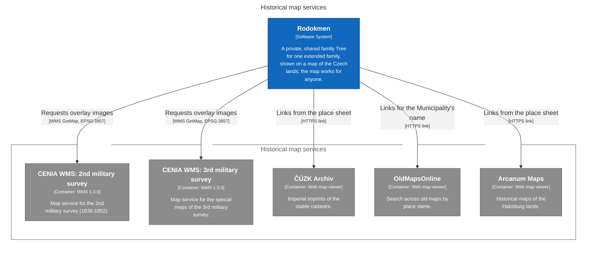

## 07-app-proposals

```mermaid
graph TB
  linkStyle default fill:#ffffff

  subgraph diagram ["App (PWA): Proposals, Drafts and review"]
    style diagram fill:#ffffff,stroke:#ffffff

    subgraph 6 ["Rodokmen"]
      style 6 fill:#ffffff,stroke:#0b4884,color:#0b4884

      subgraph 27 ["API server"]
        style 27 fill:#ffffff,stroke:#2e6295,color:#2e6295

        30["<div style='font-weight: bold'>Tree read API</div><div style='font-size: 70%; margin-top: 0px'>[Component: Recursive SQL, PostGIS]</div><div style='font-size: 80%; margin-top:10px'>Person search across Names<br />with the relation filter,<br />records, ancestors,<br />descendants and the<br />hourglass, and Events for a<br />map area, years or a Place.</div>"]
        style 30 fill:#85bbf0,stroke:#5d82a8,color:#000000
        35["<div style='font-weight: bold'>Proposals</div><div style='font-size: 70%; margin-top: 0px'>[Component: shared/src/schemas/proposals.ts]</div><div style='font-size: 80%; margin-top:10px'>Takes Proposals as typed<br />operations with base<br />versions; requires a<br />Citation; private until<br />accepted.</div>"]
        style 35 fill:#85bbf0,stroke:#5d82a8,color:#000000
        36["<div style='font-weight: bold'>Review</div><div style='font-size: 70%; margin-top: 0px'>[Component: shared/src/schemas/review.ts]</div><div style='font-size: 80%; margin-top:10px'>Accepts or rejects a whole<br />Proposal in one transaction,<br />with corrections, conflicts<br />and merges.</div>"]
        style 36 fill:#85bbf0,stroke:#5d82a8,color:#000000
        37["<div style='font-weight: bold'>History and undo</div><div style='font-size: 70%; margin-top: 0px'>[Component: Kysely]</div><div style='font-size: 80%; margin-top:10px'>Append-only log of every<br />change before and after,<br />record history, and undo of a<br />whole Proposal.</div>"]
        style 37 fill:#85bbf0,stroke:#5d82a8,color:#000000
        38["<div style='font-weight: bold'>Evidence media</div><div style='font-size: 70%; margin-top: 0px'>[Component: sharp, S3 presigner]</div><div style='font-size: 80%; margin-top:10px'>Presigned upload and view<br />links; checks uploads one at<br />a time, keeps the checked<br />bytes and makes a 2,000-pixel<br />WebP copy.</div>"]
        style 38 fill:#85bbf0,stroke:#5d82a8,color:#000000
        39["<div style='font-weight: bold'>Notifications and daily jobs</div><div style='font-size: 70%; margin-top: 0px'>[Component: In-process scheduler, Prague time]</div><div style='font-size: 80%; margin-top:10px'>Editors' digest at 18:00,<br />outcome emails, and deleting<br />images of rejected Proposals<br />after 30 days.</div>"]
        style 39 fill:#85bbf0,stroke:#5d82a8,color:#000000
      end

      subgraph 7 ["App (PWA)"]
        style 7 fill:#ffffff,stroke:#2e6295,color:#2e6295

        14["<div style='font-weight: bold'>Proposal forms</div><div style='font-size: 70%; margin-top: 0px'>[Component: app/src/propose-form.js, pickers.js]</div><div style='font-size: 80%; margin-top:10px'>Phone-first forms that turn<br />one finding into typed<br />operations with a Citation<br />and photos.</div>"]
        style 14 fill:#85bbf0,stroke:#5d82a8,color:#000000
        15["<div style='font-weight: bold'>Drafts</div><div style='font-size: 70%; margin-top: 0px'>[Component: app/src/drafts.js]</div><div style='font-size: 80%; margin-top:10px'>Keeps Drafts and their photos<br />on the device until the<br />Member submits them.</div>"]
        style 15 fill:#85bbf0,stroke:#5d82a8,color:#000000
        16["<div style='font-weight: bold'>Drafts list and my Proposals</div><div style='font-size: 70%; margin-top: 0px'>[Component: app/src/work.js, api.js]</div><div style='font-size: 80%; margin-top:10px'>Submits Drafts once online<br />and shows each Proposal's<br />status and the Editor's note.</div>"]
        style 16 fill:#85bbf0,stroke:#5d82a8,color:#000000
        17["<div style='font-weight: bold'>Review and history screens</div><div style='font-size: 70%; margin-top: 0px'>[Component: app/src/review.js]</div><div style='font-size: 80%; margin-top:10px'>Review queue with conflicts<br />and corrections, merging,<br />record history and undo;<br />Agent work is labelled.</div>"]
        style 17 fill:#85bbf0,stroke:#5d82a8,color:#000000
      end

      24[("<div style='font-weight: bold'>On-device store</div><div style='font-size: 70%; margin-top: 0px'>[Container: IndexedDB]</div><div style='font-size: 80%; margin-top:10px'>Drafts with their photos<br />until submitted, and up to<br />400 last-loaded Tree records;<br />emptied on sign-out.</div>")]
      style 24 fill:#438dd5,stroke:#2e6295,color:#ffffff
      48[("<div style='font-weight: bold'>Image bucket</div><div style='font-size: 70%; margin-top: 0px'>[Container: Garage (S3-compatible), on the VPS]</div><div style='font-size: 80%; margin-top:10px'>Private page images, photos<br />and portraits: originals,<br />display copies, and pending/<br />uploads. Reached by browsers<br />only with presigned links at<br />files.<domain>.</div>")]
      style 48 fill:#438dd5,stroke:#2e6295,color:#ffffff
    end

    14-- "<div>Looks up Persons, Places and<br />Sources to link</div><div style='font-size: 70%'>[JSON/HTTPS]</div>" -->30
    14-- "<div>Saves each finding as a Draft</div><div style='font-size: 70%'>[JS call]</div>" -->15
    15-- "<div>Keeps Drafts and photos as<br />blobs</div><div style='font-size: 70%'>[IndexedDB]</div>" -->24
    16-- "<div>Lists Drafts; warns about old<br />ones</div><div style='font-size: 70%'>[JS call]</div>" -->15
    16-- "<div>Gets an upload link per<br />photo, then completes it</div><div style='font-size: 70%'>[JSON/HTTPS]</div>" -->38
    16-- "<div>Uploads each photo to<br />pending/</div><div style='font-size: 70%'>[HTTPS PUT, presigned link]</div>" -->48
    16-- "<div>Submits with an idempotency<br />key; lists my Proposals</div><div style='font-size: 70%'>[JSON/HTTPS]</div>" -->35
    16-- "<div>Turns outcome emails on or<br />off</div><div style='font-size: 70%'>[JSON/HTTPS]</div>" -->39
    17-- "<div>Loads the queue; accepts,<br />rejects or merges</div><div style='font-size: 70%'>[JSON/HTTPS]</div>" -->36
    17-- "<div>Shows record history; undoes<br />a Proposal</div><div style='font-size: 70%'>[JSON/HTTPS]</div>" -->37
    17-- "<div>Shows Citation images</div><div style='font-size: 70%'>[HTTPS GET, presigned link]</div>" -->48

  end
```

## 08-app-family

```mermaid
graph TB
  linkStyle default fill:#ffffff

  subgraph diagram ["App (PWA): sign-in, Tree home, family screens and Settings"]
    style diagram fill:#ffffff,stroke:#ffffff

    4["<div style='font-weight: bold'>Owner</div><div style='font-size: 70%; margin-top: 0px'>[Person]</div><div style='font-size: 80%; margin-top:10px'>The one Member who invites<br />Members, assigns roles, marks<br />Family roots, issues Agent<br />tokens and keeps the Backups.</div>"]
    style 4 fill:#08427b,stroke:#052e56,color:#ffffff

    subgraph 6 ["Rodokmen"]
      style 6 fill:#ffffff,stroke:#0b4884,color:#0b4884

      subgraph 27 ["API server"]
        style 27 fill:#ffffff,stroke:#2e6295,color:#2e6295

        29["<div style='font-weight: bold'>Accounts and sign-in</div><div style='font-size: 70%; margin-top: 0px'>[Component: @simplewebauthn/server]</div><div style='font-size: 80%; margin-top:10px'>Invitations, passkeys,<br />emailed links, sessions and<br />roles; the Member's own<br />Person and language; checks<br />the session or Agent token<br />and the action on every<br />request.</div>"]
        style 29 fill:#85bbf0,stroke:#5d82a8,color:#000000
        30["<div style='font-weight: bold'>Tree read API</div><div style='font-size: 70%; margin-top: 0px'>[Component: Recursive SQL, PostGIS]</div><div style='font-size: 80%; margin-top:10px'>Person search across Names<br />with the relation filter,<br />records, ancestors,<br />descendants and the<br />hourglass, and Events for a<br />map area, years or a Place.</div>"]
        style 30 fill:#85bbf0,stroke:#5d82a8,color:#000000
        31["<div style='font-weight: bold'>Family roots and relation</div><div style='font-size: 70%; margin-top: 0px'>[Component: Proved rule in shared/, advisory lock]</div><div style='font-size: 80%; margin-top:10px'>Family roots the Owner marks,<br />and each Person's relation to<br />the family, recomputed in<br />every accepted change.</div>"]
        style 31 fill:#85bbf0,stroke:#5d82a8,color:#000000
      end

      subgraph 7 ["App (PWA)"]
        style 7 fill:#ffffff,stroke:#2e6295,color:#2e6295

        13["<div style='font-weight: bold'>Sign-in screens</div><div style='font-size: 70%; margin-top: 0px'>[Component: app/src/sign-in-screen.js, webauthn.js]</div><div style='font-size: 80%; margin-top:10px'>Accepts an invitation and<br />registers a passkey; signs in<br />with a passkey or an emailed<br />link. Emails link here.</div>"]
        style 13 fill:#85bbf0,stroke:#5d82a8,color:#000000
        14["<div style='font-weight: bold'>Proposal forms</div><div style='font-size: 70%; margin-top: 0px'>[Component: app/src/propose-form.js, pickers.js]</div><div style='font-size: 80%; margin-top:10px'>Phone-first forms that turn<br />one finding into typed<br />operations with a Citation<br />and photos.</div>"]
        style 14 fill:#85bbf0,stroke:#5d82a8,color:#000000
        17["<div style='font-weight: bold'>Review and history screens</div><div style='font-size: 70%; margin-top: 0px'>[Component: app/src/review.js]</div><div style='font-size: 80%; margin-top:10px'>Review queue with conflicts<br />and corrections, merging,<br />record history and undo;<br />Agent work is labelled.</div>"]
        style 17 fill:#85bbf0,stroke:#5d82a8,color:#000000
        18["<div style='font-weight: bold'>Tree home and family screens</div><div style='font-size: 70%; margin-top: 0px'>[Component: Preact with htm, vendored]</div><div style='font-size: 80%; margin-top:10px'>Members' home: an hourglass<br />around a focus Person they<br />can change; People search and<br />person pages; Possible<br />relatives marked, Unrelated<br />people hidden.</div>"]
        style 18 fill:#85bbf0,stroke:#5d82a8,color:#000000
        19["<div style='font-weight: bold'>Settings</div><div style='font-size: 70%; margin-top: 0px'>[Component: Preact with htm, vendored]</div><div style='font-size: 80%; margin-top:10px'>Each Member's language,<br />passkeys and sessions; for<br />the Owner invitations, roles,<br />Member–Person links and<br />Family roots.</div>"]
        style 19 fill:#85bbf0,stroke:#5d82a8,color:#000000
        20["<div style='font-weight: bold'>Family map layers</div><div style='font-size: 70%; margin-top: 0px'>[Component: Leaflet layers, app/src/pins.js]</div><div style='font-size: 80%; margin-top:10px'>Family pins grouped at low<br />zoom, the year range with<br />decade play, a Person's life<br />path, and Family here on the<br />place sheet.</div>"]
        style 20 fill:#85bbf0,stroke:#5d82a8,color:#000000
        8["<div style='font-weight: bold'>Map and place sheet</div><div style='font-size: 70%; margin-top: 0px'>[Component: app/src/map.js, place-sheet.js, i18n.js]</div><div style='font-size: 80%; margin-top:10px'>Map with archive regions and<br />the place sheet; the home for<br />visitors, a tab for Members.<br />Czech unless the reader<br />chooses English.</div>"]
        style 8 fill:#85bbf0,stroke:#5d82a8,color:#000000
      end

      24[("<div style='font-weight: bold'>On-device store</div><div style='font-size: 70%; margin-top: 0px'>[Container: IndexedDB]</div><div style='font-size: 80%; margin-top:10px'>Drafts with their photos<br />until submitted, and up to<br />400 last-loaded Tree records;<br />emptied on sign-out.</div>")]
      style 24 fill:#438dd5,stroke:#2e6295,color:#ffffff
    end

    13-- "<div>Accepts invitations,<br />registers passkeys, signs in<br />with a passkey or an emailed<br />link</div><div style='font-size: 70%'>[JSON/HTTPS]</div>" -->29
    18-- "<div>Reads who is signed in, their<br />own Person and the Family<br />roots</div><div style='font-size: 70%'>[JSON/HTTPS]</div>" -->29
    18-- "<div>Searches Persons; reads<br />person pages, Citations and<br />the hourglass</div><div style='font-size: 70%'>[JSON/HTTPS]</div>" -->30
    18-- "<div>Caches loaded records with<br />their time; empties them on<br />sign-out</div><div style='font-size: 70%'>[IndexedDB]</div>" -->24
    18-- "<div>Opens Propose a change on a<br />Person</div><div style='font-size: 70%'>[JS call]</div>" -->14
    18-- "<div>Opens a Person's history</div><div style='font-size: 70%'>[JS call]</div>" -->17
    19-- "<div>Invites, assigns roles, links<br />Members to Persons; own<br />language, passkeys and<br />sessions</div><div style='font-size: 70%'>[JSON/HTTPS]</div>" -->29
    19-- "<div>Lists, marks and removes<br />Family roots</div><div style='font-size: 70%'>[JSON/HTTPS]</div>" -->31
    4-- "<div>Invites Members, assigns<br />roles, links Members to<br />Persons, marks Family roots</div><div style='font-size: 70%'>[Browser]</div>" -->19
    20-- "<div>Reads Events in the map area<br />and years, and Events of a<br />Place</div><div style='font-size: 70%'>[JSON/HTTPS]</div>" -->30
    20-- "<div>Adds family layers for<br />signed-in Members</div><div style='font-size: 70%'>[Leaflet layers]</div>" -->8

  end
```

## 09-api-core

```mermaid
graph LR
  linkStyle default fill:#ffffff

  subgraph diagram ["API server: accounts, Tree read API and operations"]
    style diagram fill:#ffffff,stroke:#ffffff

    70["<div style='font-weight: bold'>EU email service</div><div style='font-size: 70%; margin-top: 0px'>[Software System]</div><div style='font-size: 80%; margin-top:10px'>Transactional email provider<br />in the EU, sending from the<br />Rodokmen domain.</div>"]
    style 70 fill:#8c8c8c,stroke:#616161,color:#ffffff
    74["<div style='font-weight: bold'>GitHub</div><div style='font-size: 70%; margin-top: 0px'>[Software System]</div><div style='font-size: 80%; margin-top:10px'>Hosts the code, CI and<br />deploys, the image registry,<br />the map preview and the<br />private Export repo.</div>"]
    style 74 fill:#8c8c8c,stroke:#616161,color:#ffffff

    subgraph 6 ["Rodokmen"]
      style 6 fill:#ffffff,stroke:#0b4884,color:#0b4884

      subgraph 27 ["API server"]
        style 27 fill:#ffffff,stroke:#2e6295,color:#2e6295

        28["<div style='font-weight: bold'>Pages</div><div style='font-size: 70%; margin-top: 0px'>[Component: @fastify/static]</div><div style='font-size: 80%; margin-top:10px'>Serves app/ at / from the<br />API's own origin, every file<br />with the app's<br />Content-Security-Policy and<br />no-referrer.</div>"]
        style 28 fill:#85bbf0,stroke:#5d82a8,color:#000000
        29["<div style='font-weight: bold'>Accounts and sign-in</div><div style='font-size: 70%; margin-top: 0px'>[Component: @simplewebauthn/server]</div><div style='font-size: 80%; margin-top:10px'>Invitations, passkeys,<br />emailed links, sessions and<br />roles; the Member's own<br />Person and language; checks<br />the session or Agent token<br />and the action on every<br />request.</div>"]
        style 29 fill:#85bbf0,stroke:#5d82a8,color:#000000
        30["<div style='font-weight: bold'>Tree read API</div><div style='font-size: 70%; margin-top: 0px'>[Component: Recursive SQL, PostGIS]</div><div style='font-size: 80%; margin-top:10px'>Person search across Names<br />with the relation filter,<br />records, ancestors,<br />descendants and the<br />hourglass, and Events for a<br />map area, years or a Place.</div>"]
        style 30 fill:#85bbf0,stroke:#5d82a8,color:#000000
        32["<div style='font-weight: bold'>OpenAPI</div><div style='font-size: 70%; margin-top: 0px'>[Component: @fastify/swagger, Zod]</div><div style='font-size: 80%; margin-top:10px'>Publishes /api/openapi.json,<br />generated from the same<br />shared schemas that check<br />requests.</div>"]
        style 32 fill:#85bbf0,stroke:#5d82a8,color:#000000
        33["<div style='font-weight: bold'>Health</div><div style='font-size: 70%; margin-top: 0px'>[Component: Fastify route]</div><div style='font-size: 80%; margin-top:10px'>Health check at /api/health,<br />used by deploys, the watchdog<br />and outside monitors.</div>"]
        style 33 fill:#85bbf0,stroke:#5d82a8,color:#000000
        34["<div style='font-weight: bold'>Mailer</div><div style='font-size: 70%; margin-top: 0px'>[Component: nodemailer]</div><div style='font-size: 80%; margin-top:10px'>Writes each email in the<br />recipient's language and<br />sends it over SMTP.</div>"]
        style 34 fill:#85bbf0,stroke:#5d82a8,color:#000000
        38["<div style='font-weight: bold'>Evidence media</div><div style='font-size: 70%; margin-top: 0px'>[Component: sharp, S3 presigner]</div><div style='font-size: 80%; margin-top:10px'>Presigned upload and view<br />links; checks uploads one at<br />a time, keeps the checked<br />bytes and makes a 2,000-pixel<br />WebP copy.</div>"]
        style 38 fill:#85bbf0,stroke:#5d82a8,color:#000000
      end

      subgraph 7 ["App (PWA)"]
        style 7 fill:#ffffff,stroke:#2e6295,color:#2e6295

        13["<div style='font-weight: bold'>Sign-in screens</div><div style='font-size: 70%; margin-top: 0px'>[Component: app/src/sign-in-screen.js, webauthn.js]</div><div style='font-size: 80%; margin-top:10px'>Accepts an invitation and<br />registers a passkey; signs in<br />with a passkey or an emailed<br />link. Emails link here.</div>"]
        style 13 fill:#85bbf0,stroke:#5d82a8,color:#000000
      end

      23["<div style='font-weight: bold'>Service worker</div><div style='font-size: 70%; margin-top: 0px'>[Container: Service Worker, Cache Storage]</div><div style='font-size: 80%; margin-top:10px'>Precaches the app and<br />reference data per release<br />and keeps up to 2,000 viewed<br />tiles, so the map works<br />offline.</div>"]
      style 23 fill:#438dd5,stroke:#2e6295,color:#ffffff
      45["<div style='font-weight: bold'>MCP server</div><div style='font-size: 70%; margin-top: 0px'>[Container: TypeScript, MCP SDK v2; stdio or streamable HTTP]</div><div style='font-size: 80%; margin-top:10px'>Lets AI assistants search the<br />Tree and submit Proposals; a<br />thin client of the API with<br />the Agent's token, without<br />database access.</div>"]
      style 45 fill:#438dd5,stroke:#2e6295,color:#ffffff
      47[("<div style='font-weight: bold'>Database</div><div style='font-size: 70%; margin-top: 0px'>[Container: PostgreSQL 16 with PostGIS 3.4]</div><div style='font-size: 80%; margin-top:10px'>The Tree, accounts and<br />sessions, Agent tokens,<br />Proposals and the log of<br />accepted changes; the source<br />of truth.</div>")]
      style 47 fill:#438dd5,stroke:#2e6295,color:#ffffff
      48[("<div style='font-weight: bold'>Image bucket</div><div style='font-size: 70%; margin-top: 0px'>[Container: Garage (S3-compatible), on the VPS]</div><div style='font-size: 80%; margin-top:10px'>Private page images, photos<br />and portraits: originals,<br />display copies, and pending/<br />uploads. Reached by browsers<br />only with presigned links at<br />files.<domain>.</div>")]
      style 48 fill:#438dd5,stroke:#2e6295,color:#ffffff
      49["<div style='font-weight: bold'>Watchdog</div><div style='font-size: 70%; margin-top: 0px'>[Container: Node 22, API image, cli.js watchdog]</div><div style='font-size: 80%; margin-top:10px'>Emails the Owner when the<br />health check fails for over 5<br />minutes or a Backup fails or<br />is missing.</div>"]
      style 49 fill:#438dd5,stroke:#2e6295,color:#ffffff
    end

    13-- "<div>Accepts invitations,<br />registers passkeys, signs in<br />with a passkey or an emailed<br />link</div><div style='font-size: 70%'>[JSON/HTTPS]</div>" -->29
    23-- "<div>Precaches the app at each<br />release</div><div style='font-size: 70%'>[HTTPS GET]</div>" -->28
    29-- "<div>Stores accounts, passkeys,<br />sessions and hashed tokens</div><div style='font-size: 70%'>[SQL]</div>" -->47
    29-- "<div>Sends invitations and sign-in<br />links</div><div style='font-size: 70%'>[JS call]</div>" -->34
    30-- "<div>Searches Names; walks<br />ancestors with recursive SQL</div><div style='font-size: 70%'>[SQL, PostGIS]</div>" -->47
    30-- "<div>Gets view links for images</div><div style='font-size: 70%'>[JS call]</div>" -->38
    33-- "<div>Checks the database answers</div><div style='font-size: 70%'>[SQL]</div>" -->47
    34-- "<div>Sends from the Rodokmen<br />domain</div><div style='font-size: 70%'>[SMTP, STARTTLS]</div>" -->70
    38-- "<div>Presigns links; stores the<br />checked bytes and display<br />copies; moves and deletes<br />images</div><div style='font-size: 70%'>[S3 API]</div>" -->48
    45-- "<div>Searches Persons, Places and<br />Sources; reads records,<br />ancestors and descendants</div><div style='font-size: 70%'>[JSON/HTTP(S), Agent token]</div>" -->30
    49-- "<div>Checks /api/health through<br />the public URL</div><div style='font-size: 70%'>[HTTPS]</div>" -->33
    74-- "<div>Checks /api/health after each<br />deploy</div><div style='font-size: 70%'>[HTTPS]</div>" -->33
    74-- "<div>Fails CI when routes and<br />description disagree</div><div style='font-size: 70%'>[cli.js openapi check]</div>" -->32

  end
```

## 10-api-write-path

```mermaid
graph LR
  linkStyle default fill:#ffffff

  subgraph diagram ["API server: Proposals, review and history"]
    style diagram fill:#ffffff,stroke:#ffffff

    70["<div style='font-weight: bold'>EU email service</div><div style='font-size: 70%; margin-top: 0px'>[Software System]</div><div style='font-size: 80%; margin-top:10px'>Transactional email provider<br />in the EU, sending from the<br />Rodokmen domain.</div>"]
    style 70 fill:#8c8c8c,stroke:#616161,color:#ffffff

    subgraph 6 ["Rodokmen"]
      style 6 fill:#ffffff,stroke:#0b4884,color:#0b4884

      subgraph 27 ["API server"]
        style 27 fill:#ffffff,stroke:#2e6295,color:#2e6295

        31["<div style='font-weight: bold'>Family roots and relation</div><div style='font-size: 70%; margin-top: 0px'>[Component: Proved rule in shared/, advisory lock]</div><div style='font-size: 80%; margin-top:10px'>Family roots the Owner marks,<br />and each Person's relation to<br />the family, recomputed in<br />every accepted change.</div>"]
        style 31 fill:#85bbf0,stroke:#5d82a8,color:#000000
        34["<div style='font-weight: bold'>Mailer</div><div style='font-size: 70%; margin-top: 0px'>[Component: nodemailer]</div><div style='font-size: 80%; margin-top:10px'>Writes each email in the<br />recipient's language and<br />sends it over SMTP.</div>"]
        style 34 fill:#85bbf0,stroke:#5d82a8,color:#000000
        35["<div style='font-weight: bold'>Proposals</div><div style='font-size: 70%; margin-top: 0px'>[Component: shared/src/schemas/proposals.ts]</div><div style='font-size: 80%; margin-top:10px'>Takes Proposals as typed<br />operations with base<br />versions; requires a<br />Citation; private until<br />accepted.</div>"]
        style 35 fill:#85bbf0,stroke:#5d82a8,color:#000000
        36["<div style='font-weight: bold'>Review</div><div style='font-size: 70%; margin-top: 0px'>[Component: shared/src/schemas/review.ts]</div><div style='font-size: 80%; margin-top:10px'>Accepts or rejects a whole<br />Proposal in one transaction,<br />with corrections, conflicts<br />and merges.</div>"]
        style 36 fill:#85bbf0,stroke:#5d82a8,color:#000000
        37["<div style='font-weight: bold'>History and undo</div><div style='font-size: 70%; margin-top: 0px'>[Component: Kysely]</div><div style='font-size: 80%; margin-top:10px'>Append-only log of every<br />change before and after,<br />record history, and undo of a<br />whole Proposal.</div>"]
        style 37 fill:#85bbf0,stroke:#5d82a8,color:#000000
        38["<div style='font-weight: bold'>Evidence media</div><div style='font-size: 70%; margin-top: 0px'>[Component: sharp, S3 presigner]</div><div style='font-size: 80%; margin-top:10px'>Presigned upload and view<br />links; checks uploads one at<br />a time, keeps the checked<br />bytes and makes a 2,000-pixel<br />WebP copy.</div>"]
        style 38 fill:#85bbf0,stroke:#5d82a8,color:#000000
        39["<div style='font-weight: bold'>Notifications and daily jobs</div><div style='font-size: 70%; margin-top: 0px'>[Component: In-process scheduler, Prague time]</div><div style='font-size: 80%; margin-top:10px'>Editors' digest at 18:00,<br />outcome emails, and deleting<br />images of rejected Proposals<br />after 30 days.</div>"]
        style 39 fill:#85bbf0,stroke:#5d82a8,color:#000000
      end

      subgraph 7 ["App (PWA)"]
        style 7 fill:#ffffff,stroke:#2e6295,color:#2e6295

        16["<div style='font-weight: bold'>Drafts list and my Proposals</div><div style='font-size: 70%; margin-top: 0px'>[Component: app/src/work.js, api.js]</div><div style='font-size: 80%; margin-top:10px'>Submits Drafts once online<br />and shows each Proposal's<br />status and the Editor's note.</div>"]
        style 16 fill:#85bbf0,stroke:#5d82a8,color:#000000
        17["<div style='font-weight: bold'>Review and history screens</div><div style='font-size: 70%; margin-top: 0px'>[Component: app/src/review.js]</div><div style='font-size: 80%; margin-top:10px'>Review queue with conflicts<br />and corrections, merging,<br />record history and undo;<br />Agent work is labelled.</div>"]
        style 17 fill:#85bbf0,stroke:#5d82a8,color:#000000
        19["<div style='font-weight: bold'>Settings</div><div style='font-size: 70%; margin-top: 0px'>[Component: Preact with htm, vendored]</div><div style='font-size: 80%; margin-top:10px'>Each Member's language,<br />passkeys and sessions; for<br />the Owner invitations, roles,<br />Member–Person links and<br />Family roots.</div>"]
        style 19 fill:#85bbf0,stroke:#5d82a8,color:#000000
      end

      47[("<div style='font-weight: bold'>Database</div><div style='font-size: 70%; margin-top: 0px'>[Container: PostgreSQL 16 with PostGIS 3.4]</div><div style='font-size: 80%; margin-top:10px'>The Tree, accounts and<br />sessions, Agent tokens,<br />Proposals and the log of<br />accepted changes; the source<br />of truth.</div>")]
      style 47 fill:#438dd5,stroke:#2e6295,color:#ffffff
      48[("<div style='font-weight: bold'>Image bucket</div><div style='font-size: 70%; margin-top: 0px'>[Container: Garage (S3-compatible), on the VPS]</div><div style='font-size: 80%; margin-top:10px'>Private page images, photos<br />and portraits: originals,<br />display copies, and pending/<br />uploads. Reached by browsers<br />only with presigned links at<br />files.<domain>.</div>")]
      style 48 fill:#438dd5,stroke:#2e6295,color:#ffffff
    end

    16-- "<div>Gets an upload link per<br />photo, then completes it</div><div style='font-size: 70%'>[JSON/HTTPS]</div>" -->38
    16-- "<div>Submits with an idempotency<br />key; lists my Proposals</div><div style='font-size: 70%'>[JSON/HTTPS]</div>" -->35
    16-- "<div>Turns outcome emails on or<br />off</div><div style='font-size: 70%'>[JSON/HTTPS]</div>" -->39
    17-- "<div>Loads the queue; accepts,<br />rejects or merges</div><div style='font-size: 70%'>[JSON/HTTPS]</div>" -->36
    17-- "<div>Shows record history; undoes<br />a Proposal</div><div style='font-size: 70%'>[JSON/HTTPS]</div>" -->37
    19-- "<div>Lists, marks and removes<br />Family roots</div><div style='font-size: 70%'>[JSON/HTTPS]</div>" -->31
    34-- "<div>Sends from the Rodokmen<br />domain</div><div style='font-size: 70%'>[SMTP, STARTTLS]</div>" -->70
    35-- "<div>Stores pending Proposals and<br />their operations</div><div style='font-size: 70%'>[SQL]</div>" -->47
    35-- "<div>Checks that the Proposal's<br />uploads are ready</div><div style='font-size: 70%'>[JS call]</div>" -->38
    36-- "<div>Applies all operations in one<br />transaction</div><div style='font-size: 70%'>[SQL]</div>" -->47
    36-- "<div>Logs each changed record</div><div style='font-size: 70%'>[JS call]</div>" -->37
    36-- "<div>Moves accepted images out of<br />pending/</div><div style='font-size: 70%'>[JS call]</div>" -->38
    36-- "<div>Sends the author the outcome</div><div style='font-size: 70%'>[JS call]</div>" -->39
    37-- "<div>Appends to the log; reads it<br />for history and undo</div><div style='font-size: 70%'>[SQL]</div>" -->47
    38-- "<div>Records uploads and their<br />checks</div><div style='font-size: 70%'>[SQL]</div>" -->47
    38-- "<div>Presigns links; stores the<br />checked bytes and display<br />copies; moves and deletes<br />images</div><div style='font-size: 70%'>[S3 API]</div>" -->48
    39-- "<div>Reads pending Proposals;<br />claims each daily job once</div><div style='font-size: 70%'>[SQL]</div>" -->47
    39-- "<div>Sends the digest and outcome<br />emails</div><div style='font-size: 70%'>[JS call]</div>" -->34
    39-- "<div>Deletes images of Proposals<br />rejected 30 days ago</div><div style='font-size: 70%'>[JS call]</div>" -->38
    36-- "<div>Recomputes every relation in<br />the same transaction</div><div style='font-size: 70%'>[JS call]</div>" -->31
    31-- "<div>Stores Family roots and each<br />Person's relation</div><div style='font-size: 70%'>[SQL]</div>" -->47

  end
```

## 11-api-agents-import

```mermaid
graph LR
  linkStyle default fill:#ffffff

  subgraph diagram ["API server: Agents and the Vault import"]
    style diagram fill:#ffffff,stroke:#ffffff

    4["<div style='font-weight: bold'>Owner</div><div style='font-size: 70%; margin-top: 0px'>[Person]</div><div style='font-size: 80%; margin-top:10px'>The one Member who invites<br />Members, assigns roles, marks<br />Family roots, issues Agent<br />tokens and keeps the Backups.</div>"]
    style 4 fill:#08427b,stroke:#052e56,color:#ffffff
    5["<div style='font-weight: bold'>Agent</div><div style='font-size: 70%; margin-top: 0px'>[Person]</div><div style='font-size: 80%; margin-top:10px'>An AI assistant with its own<br />Owner-issued account that<br />contributes only through<br />Proposals.</div>"]
    style 5 fill:#08427b,stroke:#052e56,color:#ffffff

    73["<div style='font-weight: bold'>Vault</div><div style='font-size: 70%; margin-top: 0px'>[Software System]</div><div style='font-size: 80%; margin-top:10px'>The Owner's Markdown notes in<br />the private rodokmen-data<br />repo, about 4,100 people with<br />scans; frozen after the<br />import.</div>"]
    style 73 fill:#ffffff,stroke:#777777,color:#555555

    subgraph 6 ["Rodokmen"]
      style 6 fill:#ffffff,stroke:#0b4884,color:#0b4884

      subgraph 27 ["API server"]
        style 27 fill:#ffffff,stroke:#2e6295,color:#2e6295

        29["<div style='font-weight: bold'>Accounts and sign-in</div><div style='font-size: 70%; margin-top: 0px'>[Component: @simplewebauthn/server]</div><div style='font-size: 80%; margin-top:10px'>Invitations, passkeys,<br />emailed links, sessions and<br />roles; the Member's own<br />Person and language; checks<br />the session or Agent token<br />and the action on every<br />request.</div>"]
        style 29 fill:#85bbf0,stroke:#5d82a8,color:#000000
        30["<div style='font-weight: bold'>Tree read API</div><div style='font-size: 70%; margin-top: 0px'>[Component: Recursive SQL, PostGIS]</div><div style='font-size: 80%; margin-top:10px'>Person search across Names<br />with the relation filter,<br />records, ancestors,<br />descendants and the<br />hourglass, and Events for a<br />map area, years or a Place.</div>"]
        style 30 fill:#85bbf0,stroke:#5d82a8,color:#000000
        35["<div style='font-weight: bold'>Proposals</div><div style='font-size: 70%; margin-top: 0px'>[Component: shared/src/schemas/proposals.ts]</div><div style='font-size: 80%; margin-top:10px'>Takes Proposals as typed<br />operations with base<br />versions; requires a<br />Citation; private until<br />accepted.</div>"]
        style 35 fill:#85bbf0,stroke:#5d82a8,color:#000000
        36["<div style='font-weight: bold'>Review</div><div style='font-size: 70%; margin-top: 0px'>[Component: shared/src/schemas/review.ts]</div><div style='font-size: 80%; margin-top:10px'>Accepts or rejects a whole<br />Proposal in one transaction,<br />with corrections, conflicts<br />and merges.</div>"]
        style 36 fill:#85bbf0,stroke:#5d82a8,color:#000000
        38["<div style='font-weight: bold'>Evidence media</div><div style='font-size: 70%; margin-top: 0px'>[Component: sharp, S3 presigner]</div><div style='font-size: 80%; margin-top:10px'>Presigned upload and view<br />links; checks uploads one at<br />a time, keeps the checked<br />bytes and makes a 2,000-pixel<br />WebP copy.</div>"]
        style 38 fill:#85bbf0,stroke:#5d82a8,color:#000000
        40["<div style='font-weight: bold'>Agent access</div><div style='font-size: 70%; margin-top: 0px'>[Component: Fixed window per Agent in PostgreSQL]</div><div style='font-size: 80%; margin-top:10px'>Agent accounts, hashed<br />revocable tokens, the<br />read-and-propose-only rule,<br />and hourly limits.</div>"]
        style 40 fill:#85bbf0,stroke:#5d82a8,color:#000000
      end

      45["<div style='font-weight: bold'>MCP server</div><div style='font-size: 70%; margin-top: 0px'>[Container: TypeScript, MCP SDK v2; stdio or streamable HTTP]</div><div style='font-size: 80%; margin-top:10px'>Lets AI assistants search the<br />Tree and submit Proposals; a<br />thin client of the API with<br />the Agent's token, without<br />database access.</div>"]
      style 45 fill:#438dd5,stroke:#2e6295,color:#ffffff
      46["<div style='font-weight: bold'>Vault importer</div><div style='font-size: 70%; margin-top: 0px'>[Container: Node 22 CLI in server/, Agent token]</div><div style='font-size: 80%; margin-top:10px'>Reads the Vault once and<br />submits one Proposal per<br />Source note as an import<br />batch; can be re-run.</div>"]
      style 46 fill:#ffffff,stroke:#777777,color:#555555
    end

    4-. "<div>Runs a dry run, then the<br />import</div><div style='font-size: 70%'>[CLI]</div>" .->46
    5-- "<div>Searches the Tree and submits<br />Proposals</div><div style='font-size: 70%'>[MCP: stdio, or streamable HTTP at /mcp]</div>" -->45
    46-. "<div>Reads notes, scans and PDFs</div><div style='font-size: 70%'>[Git checkout]</div>" .->73
    29-- "<div>Checks Agent tokens,<br />permissions and limits</div><div style='font-size: 70%'>[JS call]</div>" -->40
    4-- "<div>Creates Agents; issues and<br />revokes tokens</div><div style='font-size: 70%'>[JSON/HTTPS from the browser console, no screen yet]</div>" -->40
    4-. "<div>Accepts an import batch at<br />once</div><div style='font-size: 70%'>[Browser]</div>" .->36
    45-- "<div>Searches Persons, Places and<br />Sources; reads records,<br />ancestors and descendants</div><div style='font-size: 70%'>[JSON/HTTP(S), Agent token]</div>" -->30
    45-- "<div>Submits Proposals labelled as<br />Agent work; lists its own</div><div style='font-size: 70%'>[JSON/HTTP(S), Agent token]</div>" -->35
    46-. "<div>Submits one Proposal per<br />Source note, in one import<br />batch</div><div style='font-size: 70%'>[JSON/HTTPS, Agent token]</div>" .->35
    46-. "<div>Uploads scans as Citation<br />images, PDFs as Source<br />documents</div><div style='font-size: 70%'>[JSON/HTTPS, Agent token]</div>" .->38
    5-. "<div>Opens pull requests until<br />import day; afterwards uses<br />MCP</div><div style='font-size: 70%'>[Git]</div>" .->73

  end
```

## 12-api-research

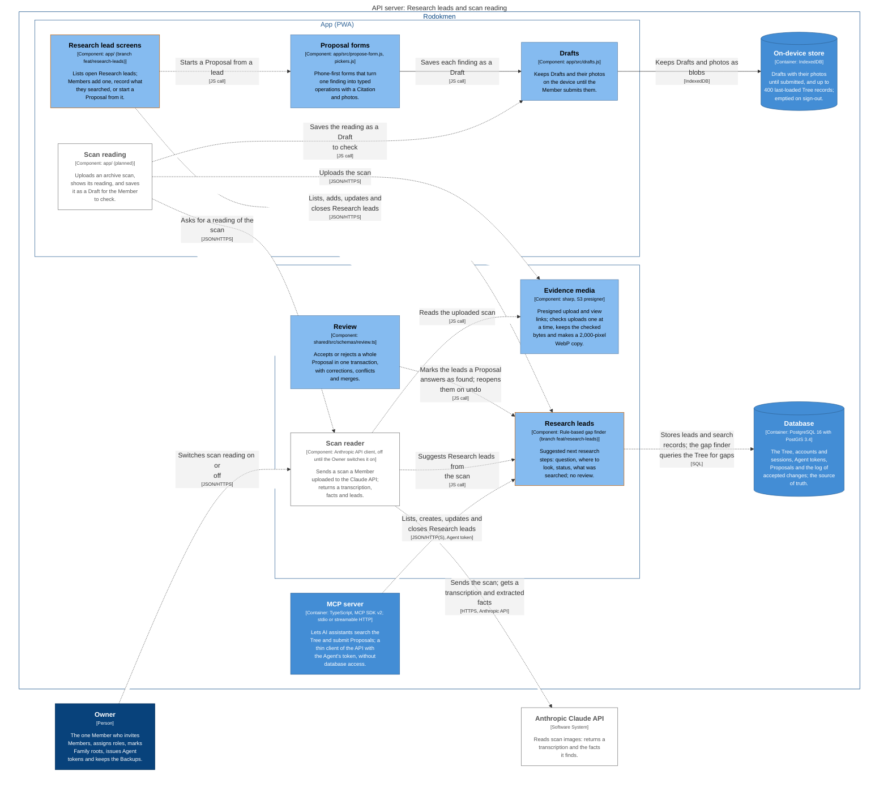

## 13-api-exports-erasure

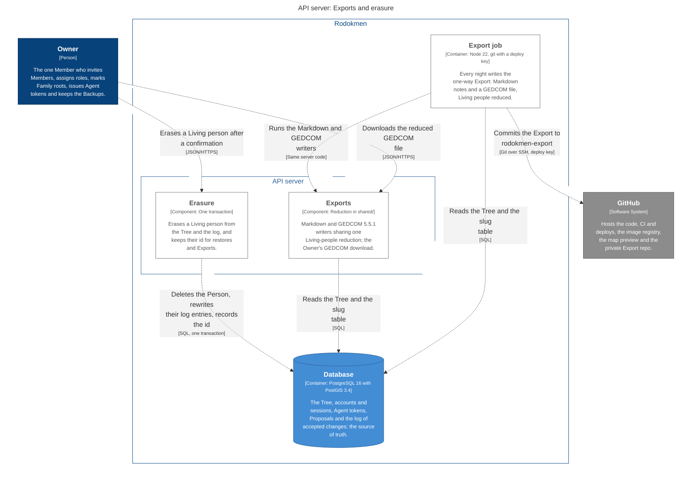

## 14-proposal-flow

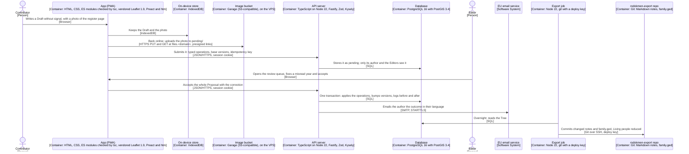

## 15-deployment

```mermaid
graph LR
  linkStyle default fill:#ffffff

  subgraph diagram ["Deployment: production"]
    style diagram fill:#ffffff,stroke:#ffffff

    subgraph 245 ["Phone or computer"]
      style 245 fill:#ffffff,stroke:#888888,color:#000000

      246["<div style='font-weight: bold'>App (PWA)</div><div style='font-size: 70%; margin-top: 0px'>[Container: HTML, CSS, ES modules checked by tsc, vendored Leaflet 1.9, Preact and htm]</div><div style='font-size: 80%; margin-top:10px'>The only interface: the map<br />for anyone; for Members<br />sign-in, the Tree home,<br />People, person pages,<br />Proposals, review and<br />Settings.</div>"]
      style 246 fill:#438dd5,stroke:#2e6295,color:#ffffff
      247["<div style='font-weight: bold'>Service worker</div><div style='font-size: 70%; margin-top: 0px'>[Container: Service Worker, Cache Storage]</div><div style='font-size: 80%; margin-top:10px'>Precaches the app and<br />reference data per release<br />and keeps up to 2,000 viewed<br />tiles, so the map works<br />offline.</div>"]
      style 247 fill:#438dd5,stroke:#2e6295,color:#ffffff
      249[("<div style='font-weight: bold'>On-device store</div><div style='font-size: 70%; margin-top: 0px'>[Container: IndexedDB]</div><div style='font-size: 80%; margin-top:10px'>Drafts with their photos<br />until submitted, and up to<br />400 last-loaded Tree records;<br />emptied on sign-out.</div>")]
      style 249 fill:#438dd5,stroke:#2e6295,color:#ffffff
    end

    subgraph 255 ["netcup"]
      style 255 fill:#ffffff,stroke:#888888,color:#000000

      subgraph 256 ["VPS"]
        style 256 fill:#ffffff,stroke:#888888,color:#000000

        257["<div style='font-weight: bold'>systemd timer</div><div style='font-size: 70%; margin-top: 0px'>[Infrastructure Node: rodokmen-backup.timer]</div><div style='font-size: 80%; margin-top:10px'>Starts the Backup job every<br />night at 02:30 Prague time.</div>"]
        style 257 fill:#ffffff,stroke:#888888,color:#000000
        subgraph 258 ["Docker Compose"]
          style 258 fill:#ffffff,stroke:#888888,color:#000000

          subgraph 259 ["caddy"]
            style 259 fill:#ffffff,stroke:#888888,color:#000000

            260["<div style='font-weight: bold'>Reverse proxy</div><div style='font-size: 70%; margin-top: 0px'>[Container: Caddy 2]</div><div style='font-size: 80%; margin-top:10px'>Serves the one domain over<br />HTTPS with automatic<br />certificates; forwards /mcp<br />to the MCP server and the<br />rest to the active API slot;<br />passes presigned image<br />requests at files.<domain> to<br />the image bucket unchanged.</div>"]
            style 260 fill:#438dd5,stroke:#2e6295,color:#ffffff
          end

          subgraph 263 ["mcp"]
            style 263 fill:#ffffff,stroke:#888888,color:#000000

            264["<div style='font-weight: bold'>MCP server</div><div style='font-size: 70%; margin-top: 0px'>[Container: TypeScript, MCP SDK v2; stdio or streamable HTTP]</div><div style='font-size: 80%; margin-top:10px'>Lets AI assistants search the<br />Tree and submit Proposals; a<br />thin client of the API with<br />the Agent's token, without<br />database access.</div>"]
            style 264 fill:#438dd5,stroke:#2e6295,color:#ffffff
          end

          subgraph 266 ["api-blue"]
            style 266 fill:#ffffff,stroke:#888888,color:#000000

            267["<div style='font-weight: bold'>API server</div><div style='font-size: 70%; margin-top: 0px'>[Container: TypeScript on Node 22, Fastify, Zod, Kysely]</div><div style='font-size: 80%; margin-top:10px'>Serves the app with its<br />Content-Security-Policy, and<br />the JSON API; runs the daily<br />jobs.</div>"]
            style 267 fill:#438dd5,stroke:#2e6295,color:#ffffff
          end

          subgraph 273 ["api-green"]
            style 273 fill:#ffffff,stroke:#888888,color:#000000

            274["<div style='font-weight: bold'>API server</div><div style='font-size: 70%; margin-top: 0px'>[Container: TypeScript on Node 22, Fastify, Zod, Kysely]</div><div style='font-size: 80%; margin-top:10px'>Serves the app with its<br />Content-Security-Policy, and<br />the JSON API; runs the daily<br />jobs.</div>"]
            style 274 fill:#438dd5,stroke:#2e6295,color:#ffffff
          end

          subgraph 280 ["db"]
            style 280 fill:#ffffff,stroke:#888888,color:#000000

            281[("<div style='font-weight: bold'>Database</div><div style='font-size: 70%; margin-top: 0px'>[Container: PostgreSQL 16 with PostGIS 3.4]</div><div style='font-size: 80%; margin-top:10px'>The Tree, accounts and<br />sessions, Agent tokens,<br />Proposals and the log of<br />accepted changes; the source<br />of truth.</div>")]
            style 281 fill:#438dd5,stroke:#2e6295,color:#ffffff
          end

          subgraph 286 ["garage"]
            style 286 fill:#ffffff,stroke:#888888,color:#000000

            287[("<div style='font-weight: bold'>Image bucket</div><div style='font-size: 70%; margin-top: 0px'>[Container: Garage (S3-compatible), on the VPS]</div><div style='font-size: 80%; margin-top:10px'>Private page images, photos<br />and portraits: originals,<br />display copies, and pending/<br />uploads. Reached by browsers<br />only with presigned links at<br />files.<domain>.</div>")]
            style 287 fill:#438dd5,stroke:#2e6295,color:#ffffff
          end

          subgraph 295 ["watchdog"]
            style 295 fill:#ffffff,stroke:#888888,color:#000000

            296["<div style='font-weight: bold'>Watchdog</div><div style='font-size: 70%; margin-top: 0px'>[Container: Node 22, API image, cli.js watchdog]</div><div style='font-size: 80%; margin-top:10px'>Emails the Owner when the<br />health check fails for over 5<br />minutes or a Backup fails or<br />is missing.</div>"]
            style 296 fill:#438dd5,stroke:#2e6295,color:#ffffff
          end

          subgraph 298 ["backup"]
            style 298 fill:#ffffff,stroke:#888888,color:#000000

            299["<div style='font-weight: bold'>Backup job</div><div style='font-size: 70%; margin-top: 0px'>[Container: pg_dump, rclone, restic]</div><div style='font-size: 80%; margin-top:10px'>Every night stores the<br />database and all images,<br />encrypted, keeping 30 daily<br />and 12 monthly Backups.</div>"]
            style 299 fill:#438dd5,stroke:#2e6295,color:#ffffff
          end

          subgraph 303 ["export"]
            style 303 fill:#ffffff,stroke:#777777,color:#555555

            304["<div style='font-weight: bold'>Export job</div><div style='font-size: 70%; margin-top: 0px'>[Container: Node 22, git with a deploy key]</div><div style='font-size: 80%; margin-top:10px'>Every night writes the<br />one-way Export: Markdown<br />notes and a GEDCOM file,<br />Living people reduced.</div>"]
            style 304 fill:#ffffff,stroke:#777777,color:#555555
          end

        end

      end

    end

    subgraph 306 ["Second EU provider"]
      style 306 fill:#ffffff,stroke:#888888,color:#000000

      307["<div style='font-weight: bold'>Backup storage</div><div style='font-size: 70%; margin-top: 0px'>[Software System]</div><div style='font-size: 80%; margin-top:10px'>Object storage at a second EU<br />provider, holding the<br />encrypted Backups.</div>"]
      style 307 fill:#8c8c8c,stroke:#616161,color:#ffffff
    end

    subgraph 309 ["EU email provider"]
      style 309 fill:#ffffff,stroke:#888888,color:#000000

      310["<div style='font-weight: bold'>EU email service</div><div style='font-size: 70%; margin-top: 0px'>[Software System]</div><div style='font-size: 80%; margin-top:10px'>Transactional email provider<br />in the EU, sending from the<br />Rodokmen domain.</div>"]
      style 310 fill:#8c8c8c,stroke:#616161,color:#ffffff
    end

    subgraph 316 ["Anthropic"]
      style 316 fill:#ffffff,stroke:#777777,color:#555555

      317["<div style='font-weight: bold'>Anthropic Claude API</div><div style='font-size: 70%; margin-top: 0px'>[Software System]</div><div style='font-size: 80%; margin-top:10px'>Reads scan images: returns a<br />transcription and the facts<br />it finds.</div>"]
      style 317 fill:#ffffff,stroke:#777777,color:#555555
    end

    246-- "<div>Fetches the app, data and<br />tiles through it</div><div style='font-size: 70%'>[Service Worker API]</div>" -->247
    246-- "<div>Keeps Drafts and photos, and<br />the last-loaded Tree records</div><div style='font-size: 70%'>[IndexedDB]</div>" -->249
    246-- "<div>Loads the app and calls the<br />JSON API</div><div style='font-size: 70%'>[HTTPS, session cookie]</div>" -->260
    260-- "<div>Forwards /mcp</div><div style='font-size: 70%'>[Streamable HTTP, port 3001]</div>" -->264
    260-- "<div>Forwards every request to the<br />active API slot</div><div style='font-size: 70%'>[HTTP, port 3000]</div>" -->267
    264-- "<div>Calls the API with the<br />Agent's token</div><div style='font-size: 70%'>[JSON/HTTP(S)]</div>" -->267
    260-- "<div>Forwards every request to the<br />active API slot</div><div style='font-size: 70%'>[HTTP, port 3000]</div>" -->274
    264-- "<div>Calls the API with the<br />Agent's token</div><div style='font-size: 70%'>[JSON/HTTP(S)]</div>" -->274
    267-- "<div>Reads and writes the Tree,<br />accounts and sessions</div><div style='font-size: 70%'>[SQL]</div>" -->281
    274-- "<div>Reads and writes the Tree,<br />accounts and sessions</div><div style='font-size: 70%'>[SQL]</div>" -->281
    246-- "<div>Uploads photos and shows<br />images</div><div style='font-size: 70%'>[HTTPS PUT and GET at files.<domain>, presigned links]</div>" -->287
    260-- "<div>Passes presigned image<br />requests at files.<domain><br />through unchanged</div><div style='font-size: 70%'>[HTTP, port 3900]</div>" -->287
    267-- "<div>Presigns view links for<br />images</div><div style='font-size: 70%'>[S3 API]</div>" -->287
    267-- "<div>Checks uploads, writes<br />display copies, moves and<br />deletes images</div><div style='font-size: 70%'>[S3 API]</div>" -->287
    274-- "<div>Presigns view links for<br />images</div><div style='font-size: 70%'>[S3 API]</div>" -->287
    274-- "<div>Checks uploads, writes<br />display copies, moves and<br />deletes images</div><div style='font-size: 70%'>[S3 API]</div>" -->287
    296-- "<div>Checks the public health<br />check every minute</div><div style='font-size: 70%'>[HTTPS]</div>" -->260
    299-- "<div>Dumps the database and counts<br />its records</div><div style='font-size: 70%'>[pg_dump]</div>" -->281
    299-- "<div>Copies every image</div><div style='font-size: 70%'>[rclone over the S3 API, read-only key]</div>" -->287
    296-- "<div>Reads the status of the last<br />Backup</div><div style='font-size: 70%'>[backup.json on a shared volume]</div>" -->299
    304-. "<div>Reads the Tree and the slug<br />table</div><div style='font-size: 70%'>[SQL]</div>" .->281
    299-- "<div>Stores encrypted,<br />deduplicated Backups</div><div style='font-size: 70%'>[restic over HTTPS]</div>" -->307
    267-- "<div>Sends invitations and sign-in<br />links</div><div style='font-size: 70%'>[SMTP, STARTTLS]</div>" -->310
    274-- "<div>Sends invitations and sign-in<br />links</div><div style='font-size: 70%'>[SMTP, STARTTLS]</div>" -->310
    296-- "<div>Sends alerts to the Owner</div><div style='font-size: 70%'>[SMTP]</div>" -->310
    267-. "<div>Sends uploaded scans for<br />reading</div><div style='font-size: 70%'>[HTTPS, API key]</div>" .->317
    274-. "<div>Sends uploaded scans for<br />reading</div><div style='font-size: 70%'>[HTTPS, API key]</div>" .->317
    257-- "<div>Starts nightly</div><div style='font-size: 70%'>[docker compose --profile jobs run]</div>" -->299

  end
```

## 16-deployment-delivery

```mermaid
graph LR
  linkStyle default fill:#ffffff

  subgraph diagram ["Deployment: delivery, Export, Agents and Vault import"]
    style diagram fill:#ffffff,stroke:#ffffff

    subgraph 251 ["Assistant's machine"]
      style 251 fill:#ffffff,stroke:#888888,color:#000000

      252["<div style='font-weight: bold'>MCP server</div><div style='font-size: 70%; margin-top: 0px'>[Container: TypeScript, MCP SDK v2; stdio or streamable HTTP]</div><div style='font-size: 80%; margin-top:10px'>Lets AI assistants search the<br />Tree and submit Proposals; a<br />thin client of the API with<br />the Agent's token, without<br />database access.</div>"]
      style 252 fill:#438dd5,stroke:#2e6295,color:#ffffff
    end

    subgraph 253 ["Owner's computer"]
      style 253 fill:#ffffff,stroke:#777777,color:#555555

      254["<div style='font-weight: bold'>Vault importer</div><div style='font-size: 70%; margin-top: 0px'>[Container: Node 22 CLI in server/, Agent token]</div><div style='font-size: 80%; margin-top:10px'>Reads the Vault once and<br />submits one Proposal per<br />Source note as an import<br />batch; can be re-run.</div>"]
      style 254 fill:#ffffff,stroke:#777777,color:#555555
    end

    subgraph 255 ["netcup"]
      style 255 fill:#ffffff,stroke:#888888,color:#000000

      subgraph 256 ["VPS"]
        style 256 fill:#ffffff,stroke:#888888,color:#000000

        subgraph 258 ["Docker Compose"]
          style 258 fill:#ffffff,stroke:#888888,color:#000000

          subgraph 266 ["api-blue"]
            style 266 fill:#ffffff,stroke:#888888,color:#000000

            267["<div style='font-weight: bold'>API server</div><div style='font-size: 70%; margin-top: 0px'>[Container: TypeScript on Node 22, Fastify, Zod, Kysely]</div><div style='font-size: 80%; margin-top:10px'>Serves the app with its<br />Content-Security-Policy, and<br />the JSON API; runs the daily<br />jobs.</div>"]
            style 267 fill:#438dd5,stroke:#2e6295,color:#ffffff
          end

          subgraph 273 ["api-green"]
            style 273 fill:#ffffff,stroke:#888888,color:#000000

            274["<div style='font-weight: bold'>API server</div><div style='font-size: 70%; margin-top: 0px'>[Container: TypeScript on Node 22, Fastify, Zod, Kysely]</div><div style='font-size: 80%; margin-top:10px'>Serves the app with its<br />Content-Security-Policy, and<br />the JSON API; runs the daily<br />jobs.</div>"]
            style 274 fill:#438dd5,stroke:#2e6295,color:#ffffff
          end

          subgraph 303 ["export"]
            style 303 fill:#ffffff,stroke:#777777,color:#555555

            304["<div style='font-weight: bold'>Export job</div><div style='font-size: 70%; margin-top: 0px'>[Container: Node 22, git with a deploy key]</div><div style='font-size: 80%; margin-top:10px'>Every night writes the<br />one-way Export: Markdown<br />notes and a GEDCOM file,<br />Living people reduced.</div>"]
            style 304 fill:#ffffff,stroke:#777777,color:#555555
          end

        end

      end

    end

    subgraph 306 ["Second EU provider"]
      style 306 fill:#ffffff,stroke:#888888,color:#000000

      307["<div style='font-weight: bold'>Backup storage</div><div style='font-size: 70%; margin-top: 0px'>[Software System]</div><div style='font-size: 80%; margin-top:10px'>Object storage at a second EU<br />provider, holding the<br />encrypted Backups.</div>"]
      style 307 fill:#8c8c8c,stroke:#616161,color:#ffffff
    end

    subgraph 320 ["GitHub"]
      style 320 fill:#ffffff,stroke:#888888,color:#000000

      321["<div style='font-weight: bold'>GitHub Actions</div><div style='font-size: 70%; margin-top: 0px'>[Container: Workflows in .github/workflows/]</div><div style='font-size: 80%; margin-top:10px'>Tests, repo guard, image<br />builds, deploys, the monthly<br />restore test and the weekly<br />portal check.</div>"]
      style 321 fill:#8c8c8c,stroke:#616161,color:#ffffff
      326["<div style='font-weight: bold'>GitHub Container Registry</div><div style='font-size: 70%; margin-top: 0px'>[Container: ghcr.io/<owner>/rodokmen-app]</div><div style='font-size: 80%; margin-top:10px'>API images tagged by commit.</div>"]
      style 326 fill:#8c8c8c,stroke:#616161,color:#ffffff
      328["<div style='font-weight: bold'>GitHub Pages</div><div style='font-size: 70%; margin-top: 0px'>[Container: Static hosting]</div><div style='font-size: 80%; margin-top:10px'>Preview of the map only, at<br />https://<owner>.github.io/rodokmen-app/.</div>"]
      style 328 fill:#8c8c8c,stroke:#616161,color:#ffffff
      330["<div style='font-weight: bold'>rodokmen-export repo</div><div style='font-size: 70%; margin-top: 0px'>[Container: Git: Markdown notes, family.ged]</div><div style='font-size: 80%; margin-top:10px'>Private repo with the nightly<br />one-way Export; nobody edits<br />it by hand.</div>"]
      style 330 fill:#ffffff,stroke:#777777,color:#555555
      332["<div style='font-weight: bold'>Vault</div><div style='font-size: 70%; margin-top: 0px'>[Software System]</div><div style='font-size: 80%; margin-top:10px'>The Owner's Markdown notes in<br />the private rodokmen-data<br />repo, about 4,100 people with<br />scans; frozen after the<br />import.</div>"]
      style 332 fill:#ffffff,stroke:#777777,color:#555555
    end

    252-- "<div>Calls the API with the<br />Agent's token</div><div style='font-size: 70%'>[JSON/HTTP(S)]</div>" -->267
    254-. "<div>Submits an import batch of<br />Proposals</div><div style='font-size: 70%'>[JSON/HTTPS, Agent token]</div>" .->267
    252-- "<div>Calls the API with the<br />Agent's token</div><div style='font-size: 70%'>[JSON/HTTP(S)]</div>" -->274
    254-. "<div>Submits an import batch of<br />Proposals</div><div style='font-size: 70%'>[JSON/HTTPS, Agent token]</div>" .->274
    321-- "<div>Deploys to the idle slot,<br />switches when healthy</div><div style='font-size: 70%'>[SSH, deploy.sh]</div>" -->267
    321-- "<div>Deploys to the idle slot,<br />switches when healthy</div><div style='font-size: 70%'>[SSH, deploy.sh]</div>" -->274
    321-- "<div>Restores the latest Backup<br />monthly and checks record and<br />image counts</div><div style='font-size: 70%'>[restic]</div>" -->307
    321-- "<div>Pushes the API image</div><div style='font-size: 70%'>[OCI]</div>" -->326
    321-- "<div>Publishes app/ on every push<br />to main</div><div style='font-size: 70%'>[Pages deploy]</div>" -->328
    304-. "<div>Commits changed notes and<br />family.ged; one fresh commit<br />after an erasure</div><div style='font-size: 70%'>[Git over SSH, deploy key]</div>" .->330
    254-. "<div>Reads notes, scans and PDFs</div><div style='font-size: 70%'>[Git checkout]</div>" .->332

  end
```
